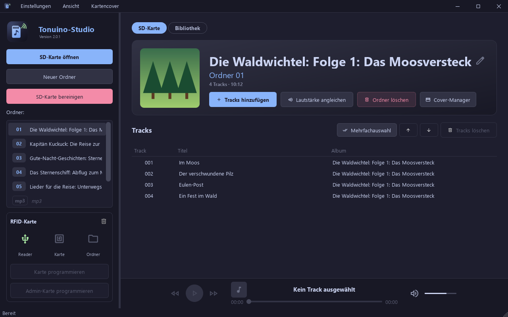

# Tonuino-Studio

Ein hübsches Tool zum Verwalten von Tonuino SD-Karten und RFID-Karten für Windows, Linux und macOS – mit KI-Kartencovern, Bibliothek für PC und NAS, Serienprofilen und Tags von MusicBrainz.

Tonuino-Studio ist ein Fork von [Tonuino-Manager](https://github.com/donschoof/tonuino-manager) (donschoof) und übernimmt dessen Weiterentwicklung regelmäßig. Beide Programme lassen sich nebeneinander installieren.



## Features

- **SD-Karten-Verwaltung**: Tonuino-Ordnerstruktur wird automatisch erkannt, Ordner anlegen/löschen
- **Tracks**: hinzufügen, löschen, umsortieren – Dateien werden automatisch lückenlos nummeriert (001.mp3, 002.mp3, …). Maximal 255 Tracks pro Ordner
- **Mehrfachauswahl** (wie in Apple Mail): „Mehrfachauswahl“ blendet Auswahlkreise ein, Löschen und Nach oben/unten wirken dann auf alle markierten Tracks, „Mehrfachauswahl beenden“ kehrt zur Einzelauswahl zurück
- **Player**: Tracks direkt anhören – Symbol beim Überfahren einer Zeile (Play/Pause), Player unten mit Cover, Titel, Interpret und Album, Playbar, Zurück/Weiter, Lautstärke und Stumm-Schalter
- **Audio-Konvertierung**: MP3, WAV, FLAC, OGG, AAC, WMA, M4A, OPUS werden automatisch nach MP3 konvertiert (FFmpeg ist enthalten)
- **Metadaten-Editor**: ID3-Tags und Cover bearbeiten (Cover per Klick, beim Überfahren erscheint „Album-Cover ändern“ bzw. „Album-Cover hinzufügen“) oder Tags durch Leeren der Felder entfernen
- **Ordnername & Cover**: aus eigenem Namen oder Album-Tag und eingebettetem Cover des ersten Tracks; ein Klick auf das Ordner-Cover öffnet den Cover-Manager
- **SD-Karte bereinigen**: entfernt alles, was nicht zur Tonuino-Struktur gehört, und nummeriert die Tracks je Ordner lückenlos neu; Ordnernummern bleiben unverändert, damit RFID-Karten gültig bleiben (mit Sicherheitsabfrage)
- **RFID-Programmierung**: Ordner- und Admin-Karten per ACR122U oder direkt über den TonUINO, mit Live-Status von Reader, Karte und Ordner in der Sidebar (siehe [RFID-Karten](#rfid-karten))
- **Kartencover**: Cover im Scheckkartenformat (85,6 × 54 mm, hoch oder quer) je Ordner – KI-Illustration per Google Gemini („Nano Banana“) auf Basis einer kurzen Internetrecherche, der Tags und des Album-Covers, oder ohne KI als „Ambient Blur“ aus dem Album-Cover. Der Titel wird per Code gesetzt (siehe [Kartencover](#kartencover))
- **Bibliothek**: zeigt die Hörspiele und Musik auf PC und NAS als Kachelgitter; Alben werden per Drag & Drop auf die SD-Karte gezogen (neuer Ordner oder vorhandener Ordner), inklusive Album-Cover und gespeichertem Kartencover aus dem Archiv (siehe [Bibliothek](#bibliothek))
- **Druckbogen**: A4-PDF für Etikettenbögen (z. B. HERMA 5028) oder zum Selbstausschneiden mit Schnittmarken, inkl. Testseite und Druck-Versatz
- **Fenster**: frei in der Größe veränderbar (Mindestgröße 900 × 600), Vollbild mit F11 oder Menü *Ansicht* (Esc beendet es), Maximieren per Doppelklick auf die Titelleiste; Größe und Zustand werden für den nächsten Start gemerkt, ebenso die Größe des Cover-Managers; Seitenleiste, Vorschau/Galerie und die Spalten des Cover-Managers lassen sich per Trennlinie verschieben. Offene Dialoge werden mit dem Hauptfenster geschlossen
- **Updates**: Prüfung beim Start (im Menü „Einstellungen“ abschaltbar oder manuell auslösbar); der Download wird gegen die von GitHub gemeldete SHA-256-Prüfsumme geprüft

## Installation

Fertige Builds auf der [Releases-Seite](https://github.com/jlach-dev/Tonuino-manager/releases/latest) – keine Python-Installation nötig, FFmpeg ist enthalten.

| System | Datei | Hinweise |
| --- | --- | --- |
| Windows | `Tonuino-Studio-<Version>-Setup.exe` | Installer, deinstallierbar über *Apps & Features* |
| macOS (Apple Silicon) | `Tonuino-Studio-<Version>-arm64.dmg` | App nach `/Applications` ziehen, beim ersten Start [Quarantäne entfernen](#hinweis-zur-signatur-macos) |
| macOS (Intel) | `Tonuino-Studio-<Version>-intel.dmg` | wie oben |
| Linux (Debian/Ubuntu) | `tonuino-studio_<Version>_amd64.deb` | `sudo apt install ./tonuino-studio_<Version>_amd64.deb` |

Portable Programmdateien (z. B. für Distributionen ohne `apt`) lassen sich mit dem [lokalen Build](#eigene-builds) erzeugen.

### Hinweis zur Signatur (macOS)

Die App ist nur ad-hoc signiert (kein Apple Developer Account). Gatekeeper meldet bei heruntergeladenen Kopien deshalb „beschädigt“ – die Datei ist in Ordnung. Quarantäne-Flag entfernen, danach startet die App normal:

```bash
xattr -cr /Applications/Tonuino-Studio.app
```

## SD-Karten-Format

```
SD-Karte/
├── 01/ … 99/   → Tonuino-Ordner mit 001.mp3, 002.mp3, …
│               (optional card.png, card_art_raw.png, card.json, card_back.png,
│                card_back_raw.png = Kartencover)
├── mp3/        → Systemordner (Ansagen), wird nicht umsortiert
└── advert/     → Systemordner (Advert), wird nicht umsortiert
```

Anzeigename und Cover eines Ordners kommen aus den ID3-Tags (eigener Name `TXXX:TONUINO_FOLDER_NAME`, sonst Album-Tag `TALB`, bzw. eingebettetes Cover `APIC` des ersten passenden Tracks), sonst „Ordner NN“ bzw. eine `cover.jpg`/`cover.png`/`folder.jpg`/`folder.png`/`front.jpg` im Ordner. **Umbenennen** (Stift neben dem Titel oder Doppelklick auf den Ordner bzw. Titel) schreibt den Namen als eigenen Tag `TXXX:TONUINO_FOLDER_NAME` in alle Tracks des Ordners, der Album-Tag bleibt unberührt; ein leerer Name gibt den Album-Tag wieder frei. Vorgeschlagen wird die aus den Tracktiteln erkannte Reihe, wenn der Ordner noch keinen Namen hat. Ein Klick auf das Cover in der Ordneransicht öffnet den Cover-Manager; **Als Album-Cover setzen** gilt dort für alle Tracks des Ordners.

**SD-Karte bereinigen** löscht unwiderruflich alles außerhalb der Ordner `01`–`99`, `mp3` und `advert`, dazu in diesen Ordnern alles, was keine MP3 ist (inkl. macOS-Metadaten wie `.DS_Store`). Erhalten bleiben in den Ordnern `01`–`99` die Kartencover-Dateien `card.png`, `card_art_raw.png`, `card.json`, `card_back.png` und `card_back_raw.png` sowie überall `.tmp_*`-Reste. Ordner ohne Tracks werden entfernt, außer sie enthalten anders benannte MP3s, ein Kartencover oder solche Reste; die Tracks in jedem Ordner lückenlos neu nummeriert; die Ordnernummern bleiben unverändert. Vorher gibt es eine Vorschau und eine Warnung, wenn das Laufwerk nicht wie eine typische SD-Karte aussieht (kein Wechseldatenträger oder über 32 GB).

## RFID-Karten

Unterstützt werden MIFARE Mini, Classic 1K/4K sowie Ultralight/NTAG21x. Der Kartentyp wird automatisch erkannt.

- **Ordnerkarten**: Ordner plus Wiedergabemodus (Hörspiel, Album, Party, Einzelner Track, Hörbuch)
- **Admin-Karten**: öffnen das Admin-Menü am TonUINO

Den Programmierweg wählst du im Menü **Einstellungen** unter **RFID-Leser**:

- **ACR122U** (Standard): USB-Reader, alle Funktionen inkl. Löschen einzelner Karten
- **TonUINO (seriell)**: Karte wird über den per USB verbundenen TonUINO und dessen eigenen Leser geschrieben, kein extra Reader nötig. Voraussetzung ist [TonUINO-TNG](https://github.com/tonuino/TonUINO-TNG) mit `#define SerialInputAsCommand` (`src/constants.hpp`). Der TonUINO muss im Leerlauf oder pausiert sein; die Karte wird erst nach der Bestätigung auf seinen Leser gelegt. Löschen ist in diesem Modus nicht möglich.

## Kartencover

Der **Cover-Manager** verwaltet zwei getrennte Dinge: das **Album-Cover** (quadratisch, in den MP3s, Anzeige in Box und App) und das **Kartencover** (Vorder-/Rückseite für den Druck auf die RFID-Karte). Ein Klick auf das Album-Cover im Ordnerkopf öffnet ihn im Album-Cover-Modus (Reiter „Cover suchen“, Bild wählen → „Als Album-Cover setzen“); **Cover-Manager** bzw. Menü **Kartencover** öffnen ihn für das Kartencover:

- **Galerie** unter der großen Kartenvorschau, filterbar nach *Aktuell* (eingebettetes Album-Cover, Kartenmotiv auf der SD), *Gefunden*, *Archiv* (alle behaltenen Cover inkl. früherer KI-Läufe) und *Neu*.
- **Cover suchen**: Suchbegriff ist die aus den Tracktiteln erkannte Reihe, sonst der Album-Tag, sonst der von der Recherche ermittelte Titel, sonst der bereinigte erste Tracktitel (nie „Ordner 01“). Quellen: **Deezer** (bis 1000 px), **Spotify** (640 px, mit eigener Client-ID/Secret), **iTunes** (bis 1200 px), **MusicBrainz**/Cover Art Archive und die **Recherche-Quellen** (Vorschaubild der gefundenen Verlags-/Shopseiten bzw. von der Recherche gemeldete Cover-URLs). Gefundene Cover sind urheberrechtlich geschützt – nur für eigene Karten verwenden.
- **Bedienung**: *Klick* auf ein Bild zeigt es nur groß in der Vorschau. **Als Vorderseite** und **Als Rückseite** unter der Vorschau weisen es der Karte zu und **speichern sofort**, ohne Rückfrage und ohne den Reiter „Karte“. Bei Bildern mit eigener Rückseite entscheidet der Umschalter *Vorderseite | Rückseite*, welche Seite genommen wird; die Knöpfe zeigen das an. Wird zuerst die Rückseite gewählt, wird sie mit der ersten Vorderseite gespeichert. Die Zeile unter der Vorschau zeigt immer den gespeicherten Stand („gespeichert ✓“). **Als Album-Cover setzen** schreibt das Cover sofort in die Audiodateien. *Haken* markieren mehrere Bilder für die Sammelaktionen **Behalten (n)** (ins Archiv), **Als KI-Vorlage (n)** und **Verwerfen (n)**. Symbole: ★ im Archiv, ○ nicht gespeichert (verschwindet beim Schließen), ◆ KI-Vorlage, ♪ Album-Cover, ▭ Kartencover. Zugewiesene Bilder landen automatisch im Archiv; die automatische Suche läuft nur, solange noch keine gefundenen Cover im Archiv liegen.
- **Ersetzen mit Sicherung**: Ein ersetztes Kartenmotiv, das noch nicht im Archiv liegt, wird ohne Rückfrage dort abgelegt. Beim Album-Cover fragt der Manager vor dem Überschreiben, ob das bisherige archiviert werden soll. Galerie und Ordneransicht werden sofort aktualisiert.
- **Kartentext**: *Reihe* (klein, z. B. „Die Fuchsbande · Folge 39“) und *Titel* mit einer Zeile je Folge. Das Zahnrad neben „Reihe“ öffnet ein Popup mit zwei Bereichen (Reihe, Titel) für Schriftart, Größe (mm oder automatisch), Fett und Farbe; jede Änderung ist sofort in der Vorschau zu sehen, „Abbrechen“ stellt die Ausgangswerte wieder her. Text, Schrift, Ausrichtung und Ordnernummer werden kurz nach der letzten Änderung automatisch gespeichert (spätestens beim Schließen). Als Vorgabe für die nächste Karte gelten nur die Ausrichtung und die Schrift, wenn du das Popup mit „Fertig“ schließt. Die Vorschau zeigt die fertige Karte mit Text nur im Reiter „Karte“, in den anderen Reitern das Bild selbst. Beides wird aus den Tags abgeleitet: Tracktitel nach dem Muster „Reihe (1/2): Folgentitel | Feed“ oder „Reihe – Folge 12: Titel“ (typisch für Podcast-Downloads, bei denen der Album-Tag nur den Feed nennt) haben Vorrang; sonst Interpret/Albuminterpret und Album-Tag, wobei Doppelfolgen wie „Fall 77: …/Fall 78: …“ und mehrere Folgen mit verschiedenen Album-Tags erkannt werden und lässt sich bearbeiten bzw. mit „Aus Tags übernehmen“ neu ermitteln.
- **KI erzeugen**: Recherche und Bild-Prompt stützen sich auf die erkannte Reihe und die Folgentitel (Zeile „Grundlage: …“ zeigt, woher sie stammen: Tracktitel, Tags oder per MusicBrainz bestätigte Tags); ein Album-Tag, der nur einen Podcast-Feed nennt, wird dem Modell ausdrücklich als solcher mitgegeben. Nach „Tags von MusicBrainz“ werden die Tags neu gelesen; die KI-Recherche läuft bei „Recherchieren“ oder vor dem nächsten KI-Aufruf erneut. Dazu Stil, eigener Wunsch, 1–4 Varianten; alle mit ◆ markierten Bilder gehen als Vorlage mit (bis zu 6). Nicht behaltene neue Varianten werden beim Schließen abgefragt.
- **Rückseite**: Cover aus dem Cover Art Archive bringen ihre Rückseite mit (Badge ⧉ in der Galerie, Umschalter *Vorderseite | Rückseite* unter der Vorschau). Im Tab „Karte“ unter *Rückseite* wählbar: *Keine*, *Original-Rückseite / gewähltes Bild*, *Ambient Blur der Vorderseite* oder *Farbverlauf aus den Coverfarben*; jede Änderung wird automatisch gespeichert. „Als Rückseite“ schaltet auf *Bild*, die Wahl bleibt auch bei einem Wechsel zu Blur/Verlauf gemerkt; „Aus Datei …“ nimmt ein Bild vom PC und speichert sofort. Die Checkbox *Trackliste auf Bild* setzt Überschrift und Trackliste aus den Tags per Code auf das Motiv. **KI-Hilfen als Knöpfe** (je 1 Bildaufruf, das Ergebnis erscheint als neues Bild unter *Neu* und wird per „Als Vorderseite“/„Als Rückseite“ zugewiesen): *Rand per KI ergänzen* erweitert das angeklickte Bild aufs Kartenformat (entfällt, wenn es schon passt); *KI-Rückseite erzeugen* malt passend zur gewählten Vorderseite ein ruhigeres Gegenstück im selben Stil, optional nach *KI-Wunsch*, „Idee vorschlagen“ lässt das Textmodell drei Szenen vorschlagen. Gespeichert wird als `card_back.png`/`card_back_raw.png` (im SD-Ordner bzw. für Bibliotheksalben im Archiv) und am Kartencover im Archiv; auf dem Druckbogen folgen Rückseiten als weitere Etiketten nach den Vorderseiten.
- **Serie**: Folgen einer Hörspielreihe bekommen über ein Serienprofil (Anker-Bilder, Stilbibel) einen einheitlichen Look, siehe [Serien](#serien).
- **Archiv**: alle behaltenen Cover liegen im **Datenordner der Bibliothek** (beim ersten Öffnen wählbar, Standard `Google Drive\Tonuino\Bibliothek-Daten`, ohne diesen Ordner `Dokumente\Tonuino-Manager\Bibliothek-Daten`; später änderbar unter *Einstellungen → Datenordner ändern …*). Auf die SD-Karte kommt nur das aktive Kartencover. Die Zuordnung Ordner ↔ Archiv erfolgt über eine Album-ID, die als Tag `TXXX:TONUINO_ALBUM_ID` in die MP3s auf der SD-Karte geschrieben wird.

**Tags von MusicBrainz** (Menü *Kartencover* oder Knopf im Reiter *Cover suchen*): Für Ordner mit falschen oder nur aus einem Podcast-Feed stammenden Tags (z. B. Album „MausHörspiel lang“, Titel „Die kleine Hexe (1/2): Heia Walpurgisnacht | …“) sucht der Manager passende Releases mit Trackliste bei **MusicBrainz** (Suchbegriff wie bei der Cover-Suche: erkannte Reihe, sonst Album-Tag), als Ersatz bei **Deezer**, **iTunes** und (mit hinterlegten Zugangsdaten) **Spotify**. Releases mit passender Trackanzahl stehen vorn. Die Tracks werden über Position und Länge (±3 s) zugeordnet, sonst über die Länge allein oder die Titelähnlichkeit; bei gleicher Anzahl zuletzt nur über die Position (gelb markiert, bitte prüfen). Die Tabelle zeigt alt → neu je Track für Album, Interpret, Albuminterpret, Titel, Tracknummer, Jahr und MusicBrainz-IDs; jede geänderte Zelle hat ein Häkchen, die Häkchen über der Tabelle schalten ganze Spalten, das Häkchen am Track die ganze Zeile. **Übernehmen** schreibt nur die angehakten Felder in die MP3-Dateien des SD-Ordners; die MusicBrainz-IDs landen wie bei Picard als `TXXX`-Tags (`MusicBrainz Album Id`, `MusicBrainz Release Group Id`, `MusicBrainz Release Track Id`, `MusicBrainz Album Artist Id`, `MusicBrainz Artist Id`). Ordnername und Trackliste werden danach aktualisiert.

### Serien

Folgen einer Hörspielreihe („Die Fuchsbande“, „Bibi Blocksberg“ …) sollen Karten mit denselben Figuren, demselben Illustrationsstil und derselben Farbwelt bekommen. Dafür gibt es **Serienprofile** im Datenordner der Bibliothek (`series/<id>/series.json`) und im Cover-Manager den Reiter **Serie**:

- **Zuordnung**: Die Reihe wird erkannt – über die MusicBrainz-Serienrelation, wenn die Tags eine Release-Group-ID tragen (nach „Tags von MusicBrainz“), sonst aus Interpret/Album-Tag bzw. den Tracktiteln. Passt sie zu einem vorhandenen Profil, wird das Album automatisch zugeordnet; sonst bietet die Auswahl „Erkannt: … (neu anlegen)“, die vorhandenen Profile, „Neue Serie …“ und „keine“. Die Zuordnung liegt beim Album im Archiv.
- **Anker-Bilder** (bis zu 4): das gerade groß angezeigte Bild (Vorder- oder Rückseite) wird mit „Angeklicktes Bild als Anker“ im Archiv behalten und als Anker gesetzt (Symbol ⚓ in der Galerie). Anker gehen bei jeder KI-Erzeugung einer Folge der Serie – Vorderseite wie KI-Rückseite, auch im Batch – als **erste** Vorlagen mit; eigene ◆-Vorlagen folgen dahinter, zusammen höchstens 6 (Anker gewinnen).
- **Stilbibel**: ein kurzer deutscher Text zu Figuren, Stil, Farben und Bildsprache, den das Textmodell mit „Vorschlagen“ aus den Anker-Bildern und der Recherche ableitet und der sich frei bearbeiten lässt. Er wird an jeden Bild-Prompt der Serie angehängt, zusammen mit der Anweisung, exakt dieselben Figuren, denselben Stil und dieselbe Palette wie die Referenzbilder zu verwenden. Ein fester **Stil** je Serie ist optional; ist er gesetzt, hat er bei Vorderseite, KI-Rückseite, Charakterblatt und Serien-Batch Vorrang vor dem Stil aus „KI erzeugen“ (der Reiter „KI erzeugen“ weist darauf hin), sonst gilt der dortige Stil.
- **Charakterblatt erzeugen** (1 Bildaufruf): ein Bild der Hauptfiguren auf neutralem Hintergrund (Anker und Stilbibel als Vorlage), das im Archiv landet und selbst Anker wird – ein guter erster Anker, wenn noch kein KI-Cover der Reihe existiert.
- **Batch**: Menü *Kartencover → Kartencover für alle Folgen der Serie ohne Cover …* wählt eine Serie, findet auf der SD-Karte alle Ordner ohne Kartencover, die ihr zugeordnet sind oder deren erkannte Reihe denselben Namen trägt, und erzeugt je Ordner ein Cover mit Ankern und Stilbibel (Kostenschätzung vorab, die Alben werden der Serie zugeordnet).

**Druckbogen**: Karten auswählen, Bogen wählen, ggf. bei einem angebrochenen Bogen weiter unten beginnen, PDF speichern und in **Originalgröße (100 %)** drucken. Die Bogenränder der HERMA 5028 sind nicht offiziell veröffentlicht – vorher die **Testseite** auf Normalpapier drucken, gegen den Bogen halten und ggf. den Druck-Versatz einstellen.

**Datenschutz**: Für KI-Kartencover übermittelt die App Titel, Tags, Recherche-Ergebnisse sowie Album-Cover und gewählte Vorlagen als Referenzbilder an Google (Gemini API); es gelten die Bedingungen von Google. Ohne API-Key bleibt alles lokal bzw. bei den Such-Diensten (MusicBrainz, Deezer, iTunes, Spotify, AcoustID).

**Gemini-API-Key**: im [Google AI Studio](https://aistudio.google.com/apikey) erstellen und unter *Kartencover → KI & Online-Dienste* eintragen (wird im Schlüsselbund des Betriebssystems gespeichert) oder als Umgebungsvariable `GEMINI_API_KEY` setzen. Die Bildgenerierung ist kostenpflichtig (grob einige Cent pro Bild). Modell-IDs (Standard: `gemini-nano-banana-2.1` für Bilder, `gemini-3.5-flash-lite` für die Recherche) sind dort ebenfalls änderbar. Für Spotify dort Client-ID und Secret einer eigenen App aus dem [Developer Dashboard](https://developer.spotify.com/dashboard) eintragen (oder `SPOTIFY_CLIENT_ID`/`SPOTIFY_CLIENT_SECRET` setzen); Spotify dient dann als Cover-Quelle und als vierte Quelle für „Tags von MusicBrainz“ bzw. „Tags nachtragen“ (ohne MusicBrainz-IDs).

## Bibliothek

Die eigene Sammlung bleibt, wo sie ist – auf dem PC, auf einem NAS, in mehreren Ordnern. Der Umschalter **SD-Karte | Bibliothek** über dem Inhaltsbereich zeigt sie als Kachelgitter (Cover, Titel, Interpret, Trackzahl, Dauer) mit Suchfeld und Serienfilter (die [Serienprofile](#serien) aus dem Cover-Manager).

- **Ordner festlegen**: Menü *Einstellungen → Bibliothek-Ordner …* (oder „Ordner …“ in der Ansicht). Jeder Ordner mit Audiodateien (MP3, FLAC, M4A, OGG, Opus, WAV) gilt als Album; Unterordner wie `CD1`/`CD2` werden zu einem Album zusammengefasst. Titel und Interpret kommen aus den Tags, das Cover aus dem ersten Track (oder `cover.jpg`).
- **Einlesen**: beim ersten Wechsel in die Ansicht und über *Bibliothek neu einlesen*; läuft im Hintergrund und liest nur Alben, deren Dateien sich geändert haben. Das Ergebnis liegt als `library_index.json` (plus Vorschaubilder in `library_thumbs/`) im Datenordner der Bibliothek – ein gerade nicht erreichbares NAS blendet seine Alben daher nicht aus, sie erscheinen mit dem Abzeichen **offline**.
- **Wiedererkennung**: Alben tragen dieselbe Album-ID (Tag `TONUINO_ALBUM_ID`) wie ihre Kopie auf der SD-Karte und ihr Eintrag im Cover-Archiv. Umbenennen oder Verschieben eines Albumordners ist dadurch egal: der Archiv-Eintrag wird auf den neuen Pfad gesetzt. Ohne ID-Tag hilft ein Fingerabdruck aus Trackzahl und Tracklängen. Abzeichen auf den Kacheln: **auf SD als 03** (Album liegt in Ordner 03 der geöffneten Karte), **Kartencover ✓** (im Archiv gibt es ein Kartencover), **neu** (noch nicht im Archiv), **offline**.
- **Drag & Drop**: Kacheln (oder Ordner aus dem Windows-Explorer) auf die Ordnerliste links ziehen – auf freie Fläche legt jedes Album einen neuen Ordner mit der nächsten freien Nummer an, auf einen Ordner mit Tracks fragt der Manager **Ersetzen / Anhängen / Abbrechen**; die Ordneransicht nimmt Alben für den gezeigten Ordner an. Die Tracks werden kopiert bzw. nach MP3 konvertiert und fortlaufend nummeriert. Danach bekommt die SD-Kopie die Album-ID, das Album wird im Archiv mit SD- und Bibliothekspfad verknüpft, ein fehlendes Album-Cover kommt aus dem Archiv in die Tracks, und liegt dort ein Kartencover, werden `card.png`/`card.json` (und die Rückseite) gleich mitgeschrieben – wie im Cover-Manager.
- **Album-ID in die Bibliothek schreiben**: Beim ersten Import fragt der Manager einmalig, ob die ID auch in die Originaldateien darf (MP3, FLAC, M4A, OGG; WAV wird übersprungen). Die Entscheidung gilt für alle weiteren Importe und lässt sich unter *Bibliothek-Ordner …* zurücksetzen. Ohne Erlaubnis bleibt die Bibliothek unangetastet; das Album wird dann über den Fingerabdruck wiedererkannt.
- **Mehrere Ordner auf einmal**: Ordner aus dem Explorer in die Liste unter *Bibliothek-Ordner …* ziehen („Ordner hinzufügen …“ öffnet den gewohnten Ordnerdialog des Systems); doppelte und verschachtelte Ordner werden gemeldet.
- **Album öffnen**: Doppelklick auf eine Kachel zeigt die Trackliste (Nummer, Titel, Dauer). Markierte Tracks lassen sich auf die Ordnerliste ziehen (neuer Ordner) oder auf einen Ordner (anhängen); auch einzelne Audiodateien aus dem Explorer werden so übernommen. Ein Teilimport verknüpft das Album genauso (ID, Cover, Kartencover).
- **Tags nachtragen …**: wie „Tags von MusicBrainz“ für SD-Ordner, aber für das Bibliotheksalbum (MP3, FLAC, M4A, OGG; WAV wird übersprungen) – mit Vorschau alt → neu.
- **Stücke erkennen …**: Audio-Fingerabdruck per [Chromaprint](https://acoustid.org/chromaprint) (`fpcalc`) und [AcoustID](https://acoustid.org) (kostenloser Key, nicht-kommerziell), Einstellungen unter *Kartencover → KI & Online-Dienste* (Key, `fpcalc`-Pfad oder „Herunterladen …“). Gehören die Dateien zu einem gemeinsamen Album, öffnet sich der Tag-Dialog mit den Ausgaben dieses Albums und ordnet die Tracks über die erkannte Aufnahme zu; sonst gibt es eine Tabelle mit dem besten Treffer je Datei (Titel, Interpret, Album).
- **Einsortieren …**: verschiebt die Dateien nach ihren Tags nach `<Quellordner>/<Interpret>/<Album>/<NN - Titel>` (Schema anpassbar), mit Vorschau; vorhandene Dateien werden nie überschrieben, leere Ursprungsordner entfernt. Die Album-ID im Tag hält die Zuordnung.
- **Cover …** (im geöffneten Album): der Cover-Manager für das Bibliotheksalbum. „Als Album-Cover setzen“ schreibt das Bild in alle Dateien des Albums (MP3, FLAC, M4A, OGG) und als `cover.jpg` in den Albumordner; das Kartencover samt Gestaltung landet im Archiv und wird beim Übertragen auf die SD-Karte geschrieben.
- **Cover nachtragen …** (Kopfzeile): Stapelsuche für alle Alben ohne Cover. Je Album in dieser Reihenfolge: Album-Cover aus dem Archiv (einmal im Cover-Manager gesetzt), Front-Cover aus dem Cover Art Archive zur MusicBrainz-Release-ID in den Tags, sonst Online-Suche (Deezer, iTunes, Spotify, MusicBrainz) mit Bewertung nach Titel, Interpret und Trackanzahl. Ein Prüfdialog zeigt je Album Vorschaubild, Quelle und Punkte; nur klare Spitzenreiter sind vorangehakt, per Rechtsklick lassen sich andere Treffer wählen, **Im Cover-Manager öffnen …** öffnet das markierte Album. Erst „Übernehmen“ schreibt die angehakten Cover in die Dateien, als `cover.jpg` und ins Archiv.
- **SD-Ansicht**: Der Ordnerkopf zeigt **aus Bibliothek: <Album>**, wenn der Ordner einem Bibliotheksalbum entspricht, und warnt, wenn die Bibliothek mehr Tracks hat als der Ordner auf der Karte.

## Entwicklung

Python 3.10+ und ein venv (auf aktuellem Debian/Ubuntu ohnehin Pflicht, siehe [PEP 668](https://peps.python.org/pep-0668/)):

```bash
git clone https://github.com/jlach-dev/Tonuino-manager.git
cd Tonuino-manager
python -m venv venv
source venv/bin/activate        # Windows: venv\Scripts\activate
pip install -r requirements-dev.txt   # nur zum Starten reicht requirements.txt
python main.py
```

`pyscard` wird je nach System beim Installieren gebaut:

- **Windows**: nichts weiter nötig
- **Linux** (Debian/Ubuntu-Namen):
  ```bash
  sudo apt install pcscd libpcsclite1 libpcsclite-dev swig \
    libxcb-cursor0 libxkbcommon-x11-0 libxcb-icccm4 libxcb-image0 \
    libxcb-keysyms1 libxcb-randr0 libxcb-render-util0 libxcb-shape0 \
    libxcb-xinerama0 libegl1 libpulse0
  ```
- **macOS**: Xcode Command Line Tools und `swig` (sonst bricht `pip install` bei `pyscard` ab, während andere Pakete installiert erscheinen):
  ```bash
  xcode-select --install
  brew install swig
  ```

### Eigene Builds

Im aktivierten venv (mit `requirements-dev.txt` installiert, enthält PyInstaller):

```bash
python build_package.py
```

Das Skript erkennt das Betriebssystem und legt das Ergebnis in `dist/` ab. Es muss auf jeder Zielplattform separat laufen. Die Version kommt aus [src/core/\_\_init\_\_.py](src/core/__init__.py).

- **Windows**: `Tonuino-Studio.exe` (portabel) und mit [Inno Setup](https://jrsoftware.org/isdl.php) zusätzlich das Setup (oder `Build_Package.bat`)
- **Linux**: `Tonuino-Studio` (portabel) und `.deb` (benötigt `dpkg-deb`)
- **macOS**: `Tonuino-Studio.app` und `.dmg` (`arm64` oder `intel`, je nach Build-Rechner)

Tests und Lint lokal:

```bash
python -m pytest -q
python -m pyflakes src main.py tests
```

CI führt Lint und Tests aus, baut jeden Push/PR auf allen Plattformen und startet die App headless als Smoketest ([build.yml](.github/workflows/build.yml)).

## Handbuch

Die Bedienungsanleitung steht in [docs/HANDBUCH.md](docs/HANDBUCH.md). Ihre Bilder zeigen nur erfundene Inhalte und entstehen mit `tools/make_manual_screenshots.py`.

## Lizenz und Herkunft

Tonuino-Studio baut auf [tonuino-manager](https://github.com/donschoof/tonuino-manager) von David Schäfer auf und ergänzt es um Bibliothek, Cover-Manager und Kartendruck.

Tonuino-Studio steht unter der **GNU General Public License v3.0**, siehe [LICENSE](LICENSE). Kommerzielle Nutzung ist erlaubt, wer die App weitergibt oder verändert weitergibt, muss den Quellcode aber unter derselben Lizenz bereitstellen. Copyright (c) 2026 jlach-dev; ohne jede Gewährleistung.

Der aus tonuino-manager übernommene Code bleibt zusätzlich unter dessen MIT-Lizenz, siehe [LICENSE-MIT-tonuino-manager.txt](LICENSE-MIT-tonuino-manager.txt). Für Änderungen, die direkt an das Original gehen (Pull Requests), gilt dessen Lizenz.

Die GPLv3 passt auch zu den mitgelieferten Bibliotheken [PyQt6](https://www.riverbankcomputing.com/software/pyqt/) (GPL-3.0) und [mutagen](https://github.com/quodlibet/mutagen) (GPL-2.0 oder neuer).

Die Releases enthalten FFmpeg (über [imageio-ffmpeg](https://github.com/imageio/imageio-ffmpeg)). Der unter Windows gebündelte Build (FFmpeg 7.1, „essentials“ von [gyan.dev](https://www.gyan.dev/ffmpeg/builds/)) ist mit `--enable-gpl --enable-version3` gebaut und steht damit unter der **GPLv3**; Quellcode und Lizenztext gibt es bei [ffmpeg.org](https://ffmpeg.org/download.html) bzw. beim jeweiligen Builder. Die Linux- und macOS-Builds stammen ebenfalls aus imageio-ffmpeg und wurden hier nicht auf ihre Lizenz geprüft. Für das mitgelieferte FFmpeg gelten dessen eigene Lizenzbedingungen.

Enthält [Material Symbols](https://github.com/google/material-design-icons) (Apache License 2.0, siehe `src/resources/fonts/MaterialIcons-LICENSE.txt`).
