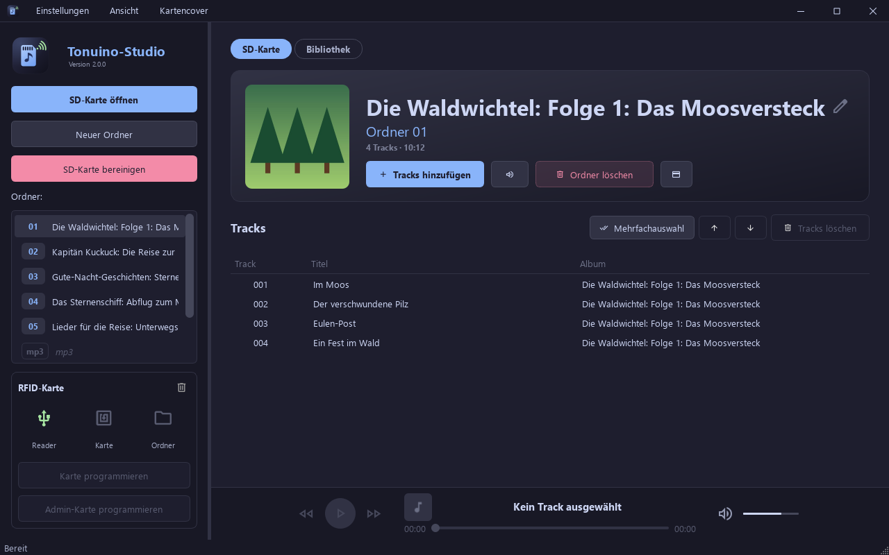
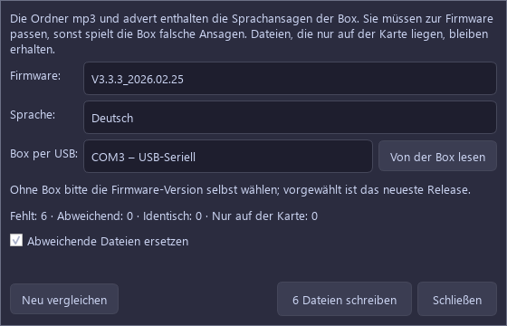
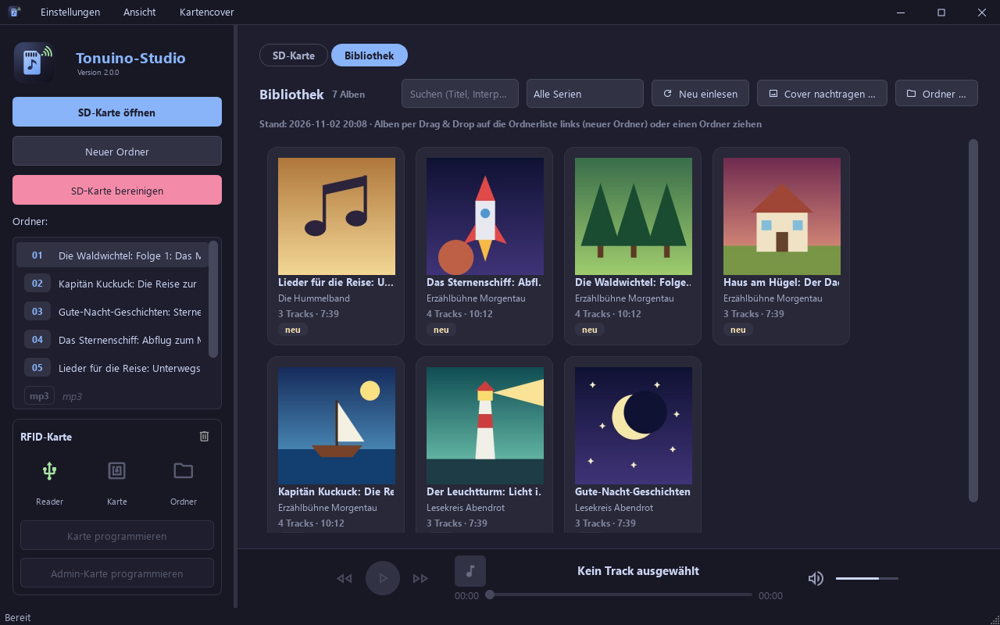
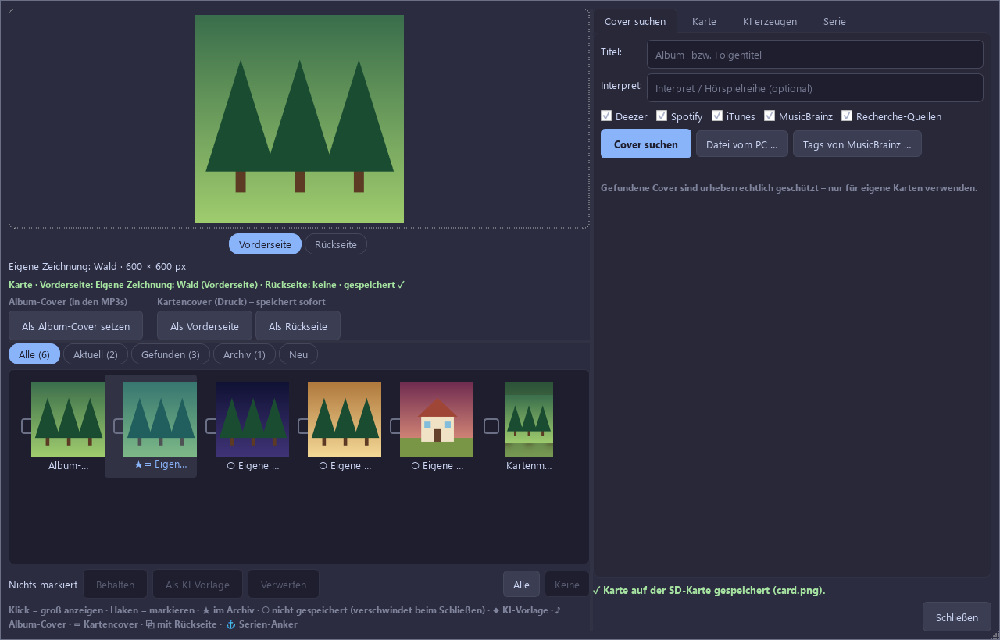
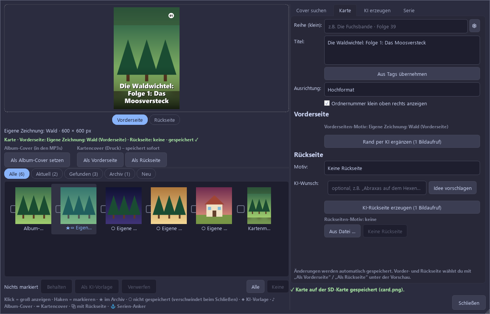
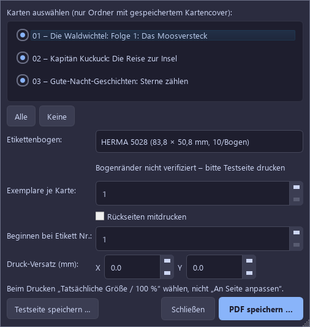
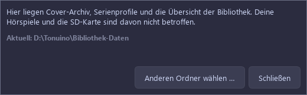

# Tonuino-Studio – Benutzerhandbuch

Gilt für Version 2.0.0. Fett gesetzte Wörter sind die Beschriftungen aus dem Programm.

> Die Bilder zeigen die echte Oberfläche, aber erfundene Hörspiele mit selbst gezeichneten Covern. Sie entstehen mit `tools/make_manual_screenshots.py`.

## Inhalt

1. [Was die App kann](#1-was-die-app-kann)
2. [Voraussetzungen, Installation, Start](#2-voraussetzungen-installation-start)
3. [Das Hauptfenster](#3-das-hauptfenster)
4. [Erste Schritte: vom Album zur fertigen Karte](#4-erste-schritte-vom-album-zur-fertigen-karte)
5. [SD-Karte](#5-sd-karte)
6. [Bibliothek](#6-bibliothek)
7. [Cover-Manager](#7-cover-manager)
8. [Karte gestalten](#8-karte-gestalten)
9. [KI-Motive und Serien](#9-ki-motive-und-serien)
10. [Drucken](#10-drucken)
11. [RFID-Karten](#11-rfid-karten)
12. [Audio-Player](#12-audio-player)
13. [Einstellungen, Dienste und API-Keys](#13-einstellungen-dienste-und-api-keys)
14. [Wo Daten liegen und Sicherung](#14-wo-daten-liegen-und-sicherung)
15. [Fehlerbehebung](#15-fehlerbehebung)
16. [Häufige Fragen](#16-häufige-fragen)
17. [Lizenz und Herkunft](#17-lizenz-und-herkunft)

---

## 1. Was die App kann

Tonuino-Studio befüllt die SD-Karte einer TonUINO-Box und erstellt die passenden Karten dazu.

- **SD-Karte verwalten:** Ordner anlegen und löschen, Tracks hinzufügen, sortieren und löschen, Lautstärke angleichen. Fremde Formate werden automatisch nach MP3 umgewandelt, die Dateien automatisch als `001.mp3`, `002.mp3` … benannt.
- **Bibliothek:** deine Hörspiele und deine Musik auf PC oder NAS (Netzwerkspeicher) als Kacheln ansehen und per Ziehen auf die SD-Karte bringen.
- **Tags pflegen:** Tags sind die Infos in einer Audiodatei, etwa Titel, Album und Interpret. Die App holt sie aus dem Internet und zeigt dir vorher, was sich ändert.
- **Cover:** Album-Cover (quadratisch, steckt in den Audiodateien) und Kartencover (Vorder- und Rückseite für den Druck) suchen, wählen oder per KI (künstliche Intelligenz) erzeugen lassen.
- **Drucken:** Kartencover als A4-PDF für Etikettenbögen oder zum Selbstausschneiden.
- **RFID-Karten programmieren:** RFID ist die Funktechnik der Karten, die du auf die Box legst. Die App beschreibt sie über einen USB-Leser oder über den TonUINO selbst.
- **Anhören:** Tracks direkt im Programm abspielen.

Für das Befüllen und Programmieren brauchst du kein Konto und keinen Key. Keys sind nur für KI-Funktionen, Spotify und die Stückerkennung nötig.

---

## 2. Voraussetzungen, Installation, Start

### Das brauchst du

- Windows, macOS oder Linux (Debian/Ubuntu für das fertige Paket)
- einen SD-Kartenleser
- optional einen RFID-Leser **ACR122U** oder einen per USB verbundenen TonUINO (siehe [RFID-Karten](#11-rfid-karten))
- optional Internet für Cover- und Tag-Suche sowie KI
- optional Etikettenbögen oder Fotopapier zum Drucken

### Installieren

Die fertigen Programme liegen auf der [Releases-Seite](https://github.com/jlach-dev/Tonuino-manager/releases/latest). Python brauchst du dafür nicht, FFmpeg (das Programm zum Umwandeln von Audio) ist enthalten.

| System | Datei | So geht's |
| --- | --- | --- |
| Windows | `Tonuino-Studio-<Version>-Setup.exe` | Ausführen. Die Installation braucht Administratorrechte. Deinstallieren über *Apps & Features*. |
| macOS (Apple Silicon) | `Tonuino-Studio-<Version>-arm64.dmg` | App nach „Programme“ ziehen, dann den Hinweis unten beachten. |
| macOS (Intel) | `Tonuino-Studio-<Version>-intel.dmg` | wie oben |
| Debian/Ubuntu | `tonuino-studio_<Version>_amd64.deb` | `sudo apt install ./tonuino-studio_<Version>_amd64.deb` |

**macOS:** Die App ist nicht bei Apple registriert, deshalb meldet macOS beim Download „beschädigt“. Die Datei ist in Ordnung. Einmal im Terminal ausführen:

```bash
xattr -cr /Applications/Tonuino-Studio.app
```

Tonuino-Studio lässt sich neben dem Original Tonuino-Manager installieren.

### Aus dem Quellcode starten (für Bastler)

Du brauchst Python 3.10 oder neuer. Im Projektordner:

```bash
python -m venv venv
source venv/bin/activate        # Windows: venv\Scripts\activate
pip install -r requirements.txt
python main.py
```

Unter Linux und macOS braucht das Paket `pyscard` beim Installieren zusätzliche Systempakete; die Liste steht im `README.md`.

### Updates

Beim Start sucht die App nach einer neuen Version. Abschalten kannst du das im Menü **Einstellungen** mit **Automatisch nach Updates suchen**, von Hand prüfst du mit **Nach Updates suchen**. Gibt es eine neue Version, wählst du **Jetzt aktualisieren**, **Später** oder **Diese Version ignorieren**.

---

## 3. Das Hauptfenster



**Links** steht die Seitenleiste: **SD-Karte öffnen**, **Neuer Ordner**, **SD-Karte bereinigen**, die Liste **Ordner:** und darunter der Bereich **RFID-Karte**.

**Rechts** schaltest du oben zwischen den Reitern **SD-Karte** und **Bibliothek** um. Ganz unten sitzt der Player.

**Menüs:**

| Menü | Einträge |
| --- | --- |
| **Einstellungen** | **Nach Updates suchen**, **Über Tonuino-Studio …**, **Automatisch nach Updates suchen**, **Alle MP3 Dateien anzeigen**, **Design** (**Dunkel**, **Hell**), **RFID-Leser** (**ACR122U**, **TonUINO (seriell)**), **Bibliothek-Ordner …**, **Bibliothek neu einlesen**, **Datenordner ändern …**, **TonUINO-Systemdateien …** |
| **Ansicht** | **Vollbild** (F11, Esc beendet es), **Maximieren / Wiederherstellen** |
| **Kartencover** | **Cover-Manager für diesen Ordner …**, **Kartencover für alle Ordner ohne Cover …**, **Kartencover für alle Folgen der Serie ohne Cover …**, **Druckbogen (PDF) erstellen …**, **Tags von MusicBrainz …**, **KI & Online-Dienste (Gemini, Spotify) …** |

Ein neues Design wirkt erst nach einem Neustart; die App bietet dafür **Jetzt neu starten** an.

**Tipp:** In einem schmalen Fenster zeigen manche Knöpfe nur noch ein Symbol, zum Beispiel **Lautstärke angleichen**, **Cover-Manager**, **Neu einlesen**, **Cover nachtragen …** und **Ordner …**. Fährst du mit der Maus darüber, erscheint ein kurzer Hinweistext (Tooltip). Ziehst du das Fenster breiter, ist die Beschriftung wieder da. Die Trennlinien zwischen Seitenleiste und Inhalt sowie im Cover-Manager lassen sich verschieben.

---

## 4. Erste Schritte: vom Album zur fertigen Karte

1. **SD-Karte einlegen und öffnen.** Klicke **SD-Karte öffnen** und wähle das Hauptverzeichnis der Karte, nicht einen Unterordner.
2. **Bibliothek einrichten.** Wechsle zum Reiter **Bibliothek** und klicke **Ordner …**. Beim ersten Mal fragt die App nach dem **Datenordner der Bibliothek**: Dort liegen später dein Cover-Archiv und die Serien. Bestätige mit **Übernehmen** oder wähle **Anderen Ordner wählen …**. Klicke dann **Ordner hinzufügen …**, wähle den Ordner mit deinen Hörspielen und bestätige mit **Übernehmen**. Die App liest die Alben ein.
3. **Album auf die Karte bringen.** Ziehe eine Kachel auf die Ordnerliste links, auf eine freie Fläche. Oder klicke die Kachel mit rechts und wähle **Auf SD-Karte übertragen**. Das Album bekommt die nächste freie Ordnernummer, die Tracks werden kopiert und umgewandelt. Beim ersten Mal fragt die App, ob sie eine Album-ID in deine Originaldateien schreiben darf ([Erklärung](#album-id)).
4. **Cover wählen.** Wechsle zum Reiter **SD-Karte**, klicke den Ordner an und dann **Cover-Manager**. Die App sucht von selbst nach Covern. Klicke ein Bild in der Galerie an, dann auf **Als Vorderseite**. Damit ist die Karte gespeichert.
5. **Text prüfen.** Im Reiter **Karte** passt du **Reihe (klein)** und **Titel** an. Das speichert sich von selbst. Klicke dann **Schließen**.
6. **Drucken.** Menü **Kartencover** → **Druckbogen (PDF) erstellen …**. Beim ersten Mal **Testseite speichern …** nutzen und auf Normalpapier gegen den Bogen halten. Dann **PDF speichern …** und in tatsächlicher Größe (100 %) drucken. Etikett auf die RFID-Karte kleben.
7. **RFID-Karte programmieren.** Karte auf den Leser legen, Ordner auswählen, **Karte programmieren** klicken, Modus wählen (etwa **Album (alle Tracks der Reihe nach)**) und mit **Ja** bestätigen.
8. **Fertig.** SD-Karte über das Betriebssystem sicher auswerfen und in die Box stecken.

Ohne Bibliothek ersetzt du die Schritte 2 und 3 durch **Neuer Ordner** und **Tracks hinzufügen**. Den Datenordner fragt die App dann beim ersten Öffnen des Cover-Managers ab.

---

## 5. SD-Karte

### Aufbau der Karte

```
SD-Karte/
├── 01/ … 99/   Ordner mit 001.mp3, 002.mp3, …  (dazu ggf. die Kartencover-Dateien)
├── mp3/        Systemordner für Ansagen
└── advert/     Systemordner (Advert)
```

Die Grenzen: 99 Ordner, 255 Tracks je Ordner. Die Systemordner **mp3** und **advert** erscheinen in der Liste, du kannst sie anhören, aber nicht bearbeiten und nichts hineinziehen.

### Karte öffnen

**SD-Karte öffnen** merkt sich den letzten Pfad. Ziehst du die Karte während der Arbeit ab, meldet die App **SD-Karte entfernt** und setzt die Ansicht zurück. Öffne sie danach einfach neu.

### Ordner

- **Neuer Ordner** legt den Ordner mit der nächsten freien Nummer an.
- **Umbenennen:** Doppelklick auf den Ordner oder Titel, oder der Knopf mit dem Tooltip **Ordner umbenennen (der Name wird in die Tags der Tracks geschrieben)**. Der Name landet in einem eigenen Tag aller Tracks; dein Album-Tag bleibt unberührt. Leerst du das Feld, gilt wieder der Album-Tag. Enter oder ein Klick daneben übernimmt, Esc verwirft. Der Ordner muss dafür Tracks enthalten. Die Nummer auf der Karte ändert sich nie.
- **Ordner löschen** entfernt den Ordner samt Inhalt nach einer Rückfrage endgültig.
- Der Kopf des Ordners zeigt **aus Bibliothek: …**, wenn der Ordner zu einem Bibliotheksalbum gehört, und warnt, wenn die Bibliothek mehr Tracks hat als die Karte.

### Tracks

- **Tracks hinzufügen** nimmt MP3, WAV, FLAC, OGG, AAC, WMA, M4A und OPUS. Alles außer MP3 wird umgewandelt. Aus dem Explorer kannst du MP3, FLAC, M4A, OGG, Opus und WAV auf die Ordneransicht ziehen; AAC und WMA gehen nur über **Tracks hinzufügen**.
- **Sortieren:** Track anklicken, dann die Knöpfe mit den Tooltips **Track nach oben verschieben** und **Track nach unten verschieben**. Die Dateien werden lückenlos neu nummeriert.
- **Mehrfachauswahl** blendet Auswahlkreise ein; Verschieben und **Tracks löschen** gelten dann für alle markierten. **Mehrfachauswahl beenden** kehrt zurück.
- **Tracks löschen** fragt vorher nach.
- **Tags bearbeiten:** Doppelklick auf einen Track öffnet **Track bearbeiten** mit **Titel**, **Künstler**, **Album**, **Track-Nr**, **Genre** und **Jahr**. Ein leeres Feld entfernt den Tag. Ein Klick auf das Cover wählt ein neues Bild nur für diesen Track.
- **Lautstärke angleichen** misst alle Tracks und gleicht sie auf −16 LUFS an (LUFS ist das Maß für empfundene Lautstärke). Passende Tracks bleiben unverändert, alle anderen werden neu kodiert und die Originale ersetzt. Das lässt sich nicht rückgängig machen.
- **Alle MP3 Dateien anzeigen** (Menü **Einstellungen**) zeigt auch MP3s mit anderen Namen. Du kannst sie abspielen, löschen und ihre Tags bearbeiten, aber nicht verschieben.

### Tags aus dem Internet

**Tags von MusicBrainz …** (Menü **Kartencover** oder Reiter **Cover suchen** im Cover-Manager) ist für Ordner mit falschen Tags gedacht, etwa wenn als Album nur der Name eines Podcasts steht. So gehst du vor:

1. **Titel** und **Interpret** prüfen, **Quellen** wählen (**MusicBrainz**, **Deezer**, **iTunes**, **Spotify**), **Suchen**. Beim Öffnen läuft die Suche schon einmal von selbst.
2. Unter **Release** (eine bestimmte Ausgabe eines Albums) die passende wählen. Ausgaben mit passender Trackzahl stehen vorn.
3. Die Tabelle zeigt je Track alt → neu. Die Häkchen unter **Felder** schalten ganze Spalten, die am Track ganze Zeilen, die in den Zellen einzelne Werte.
4. Spalte **Zuordnung** prüfen: **Position + Länge**, **Länge** oder **Titel** sind die sichereren Wege. **nur Position** ist gelb markiert und sollte von dir geprüft werden.
5. **Übernehmen** und mit **Ja** bestätigen.

Nur MusicBrainz liefert auch die MusicBrainz-IDs. Mit ihnen funktionieren die Serienerkennung und die spätere Cover-Stapelsuche besser.

### TonUINO-Systemdateien



**Einstellungen** → **TonUINO-Systemdateien …** richtet die Ansagen in den Ordnern **mp3** und **advert** ein oder aktualisiert sie, auch auf einer leeren Karte. Die Dateien kommen aus den Releases von TonUINO-TNG auf GitHub und werden gegen deren Prüfsummen geprüft.

1. Öffne die SD-Karte.
2. Wähle unter **Firmware** die Version deiner Box. Mit USB-Verbindung liest **Von der Box lesen** sie aus; die Box startet dabei meist neu. Ist die Box schon mit der App verbunden, trenne sie vorher. Unter **Sprache** wählst du Deutsch, English oder Français.
3. Prüfe den Vergleich: **Fehlt**, **Abweichend**, **Identisch**, **Nur auf der Karte**.
4. Klicke **Dateien schreiben**.

Die Ansagen müssen zur Firmware passen, sonst spielt die Box falsche Sätze. Vorgewählt ist das neueste Release, nicht unbedingt deine Version. Dateien, die nur auf der Karte liegen, bleiben erhalten. **Abweichende Dateien ersetzen** ist vorab gesetzt und überschreibt nach einer Rückfrage auch geänderte Dateien, etwa eigene Aufnahmen. Ein Abbruch lässt die fertigen Dateien stehen.

### SD-Karte bereinigen

**SD-Karte bereinigen** löscht alles, was nicht zur TonUINO-Struktur gehört, zum Beispiel fremde Dateien und Ordner sowie leere Ordner, und nummeriert die Tracks je Ordner neu. Die Ordnernummern bleiben, deine RFID-Karten gelten also weiter.

- Eine Vorschau listet auf, was gelöscht wird. Das Löschen ist endgültig.
- Erhalten bleiben die Kartencover-Dateien. Auch Ordner ohne gültige Tracks bleiben, wenn sie anders benannte MP3s, ein Kartencover oder Reste eines abgebrochenen Kopiervorgangs enthalten; die App nennt sie dir zum Prüfen.
- Sieht das Laufwerk nicht wie eine SD-Karte aus (kein Wechseldatenträger oder größer als 32 GB), warnt **Ungewöhnliches Laufwerk**. Lies dann genau, welches Laufwerk gemeint ist.

### Backup

Die App hat keine eigene Backup-Funktion. Sichere die Karte selbst, siehe [Sicherung](#sicherung).

### Typische Fehler

| Meldung | Bedeutung und Abhilfe |
| --- | --- |
| **Die SD-Karte konnte nicht gelesen werden.** | Karte neu einstecken, im Dateimanager prüfen, erneut öffnen. |
| **Maximale Anzahl von 99 Ordnern erreicht!** | Einen Ordner löschen. |
| **Zu viele Tracks** / **Ordner voll** | Mehr als 255 Tracks passen nicht in einen Ordner. Nur die ersten werden kopiert. Teile das Album auf zwei Ordner auf. |
| **Einige Tracks konnten nicht hinzugefügt werden** | Die Meldung nennt die Datei. Oft ist die Datei beschädigt oder gesperrt. |
| **Kein Ordner gewählt** | Einen Ordner mit Tracks auswählen. |
| **Bitte warten** | Ein Kopier- oder Suchvorgang läuft noch. |

---

## 6. Bibliothek



Deine Sammlung bleibt, wo sie ist. Die App merkt sich nur eine Übersicht davon im Datenordner.

### Ordner festlegen und einlesen

**Ordner …** oder Menü **Einstellungen** → **Bibliothek-Ordner …** öffnet die Liste. **Ordner hinzufügen …** wählt einen Ordner; mehrere ziehst du aus dem Explorer in die Liste. **Entfernen** nimmt einen wieder heraus (die Dateien bleiben). Doppelte und verschachtelte Ordner werden gemeldet. **Übernehmen** startet das Einlesen.

Jeder Ordner mit Audiodateien (MP3, FLAC, M4A, OGG, Opus, WAV) gilt als Album. Unterordner wie `CD1` und `CD2` werden zusammengefasst.

Eingelesen wird beim ersten Wechsel in den Reiter und mit **Neu einlesen**. Dabei werden nur geänderte Alben neu gelesen. Ein gerade nicht erreichbares NAS blendet seine Alben nicht aus; sie erscheinen mit dem Abzeichen **offline**.

### Kacheln

Jede Kachel zeigt Cover, Titel, Interpret, Trackzahl, Dauer und Abzeichen:

| Abzeichen | Bedeutung |
| --- | --- |
| **auf SD als 03** | Das Album liegt in Ordner 03 der geöffneten Karte. |
| **Kartencover ✓** | Im Archiv gibt es ein Kartencover. |
| **neu** | Das Album ist noch nicht im Archiv. |
| **offline** | Der Speicherort ist gerade nicht erreichbar. |

Oben findest du das Suchfeld und den Serienfilter (**Alle Serien**, **Ohne Serie**, deine Serien). Mit Strg oder Umschalt markierst du mehrere Kacheln.

Rechtsklick auf eine Kachel: **Öffnen**, **Cover …**, **Tags nachtragen …**, **Stücke erkennen …**, **Einsortieren …**, **Auf SD-Karte übertragen**, **Im Explorer zeigen**, **Pfad kopieren**. Bei Offline-Alben geht nur **Pfad kopieren**.

Doppelklick öffnet das Album mit Trackliste und denselben Knöpfen. **Zurück zur Übersicht** führt zurück.

### Auf die SD-Karte übertragen

Die SD-Karte muss geöffnet sein. Ziehe dann:

- **auf eine freie Fläche der Ordnerliste:** Jedes Album bekommt einen neuen Ordner.
- **auf einen Ordner mit Tracks:** Die App fragt **Ersetzen**, **Anhängen** oder **Abbrechen**. Bei mehreren Alben ersetzt nur das erste, die weiteren werden angehängt.
- **auf die Ordneransicht:** Das gilt für den gerade gezeigten Ordner.

Einzelne Tracks: Album öffnen, Tracks markieren (**Alle** markiert alle), auf die Ordnerliste oder einen Ordner ziehen. Auf einem Ordner werden sie angehängt, auf der freien Fläche der Ordnerliste kommen sie in einen neuen Ordner. Auch Ordner und Audiodateien aus dem Explorer lassen sich so ziehen.

Beim **Ersetzen** kopiert die App zuerst in einen Zwischenordner. Brichst du ab oder klappt nichts, bleiben die alten Tracks erhalten.

Nach dem Kopieren geschieht von selbst: Die Kopie auf der SD-Karte bekommt die Album-ID, ein fehlendes Album-Cover kommt aus dem Archiv in die Tracks, und ein Kartencover aus dem Archiv wird mit auf die Karte geschrieben. Hängst du an einen Ordner an, der schon das Kartencover eines anderen Albums hat, bleibt dieses.

### Album-ID

Die Album-ID ist ein kleiner Tag (`TXXX:TONUINO_ALBUM_ID`), an dem die App ein Album wiedererkennt, auch wenn du es umbenennst oder verschiebst. Auf die SD-Karte kommt sie immer. Beim ersten Import fragt die App einmalig, ob sie auch in deine Originaldateien darf (MP3, FLAC, M4A, OGG; WAV wird übersprungen, die Musik selbst bleibt unverändert). Lehnst du ab, bleibt die Bibliothek unangetastet und die Zuordnung ist weniger robust. Unter **Bibliothek-Ordner …** setzt du die Antwort mit **Entscheidung zurücksetzen** zurück.

### Tags nachtragen

**Tags nachtragen …** funktioniert wie [Tags von MusicBrainz](#tags-aus-dem-internet), schreibt aber in die Dateien der Bibliothek (MP3, FLAC, M4A, OGG; WAV wird übersprungen).

### Stücke erkennen (AcoustID)

Für Dateien mit unklaren Namen und ohne Tags: **Stücke erkennen …** berechnet mit dem kleinen Programm `fpcalc` einen Audio-Fingerabdruck und fragt damit den Dienst AcoustID. Du brauchst dafür einen Key und `fpcalc`, siehe [AcoustID](#acoustid-und-fpcalc). Fehlt eines davon, bietet die App an, die Einstellungen zu öffnen.

Sind Tracks markiert, werden nur diese erkannt, sonst das ganze Album. Dann gibt es zwei Ergebnisse:

- **Mindestens die abgerundete Hälfte der Dateien gehört zu einem Album (bei 3 Dateien reicht eine):** Der Tag-Dialog öffnet sich mit den Ausgaben dieses Albums. Die Tracks werden über die erkannte Aufnahme zugeordnet.
- **Kein gemeinsames Album:** Der Dialog **Stücke erkannt** zeigt je Datei den besten Treffer mit **Sicherheit** in Prozent. Häkchen setzen, **Tags übernehmen**, mit **Ja** bestätigen. Geschrieben werden Titel und Interpret und, sofern bekannt, Album und Albuminterpret.

### Einsortieren

**Einsortieren …** verschiebt Dateien nach ihren Tags in eine Ordnerstruktur. Vorgabe für **Schema:** ist

```
{albumartist}/{album}/{track:02d} - {title}
```

Platzhalter: `{albumartist}`, `{artist}`, `{album}`, `{title}`, `{track:02d}`, `{disc}`, `{year}`. Die Tabelle zeigt **Datei**, **Ziel** und **Status** (**wird verschoben**, **liegt schon richtig**, **Tags fehlen**, **Konflikt**, **Pfad zu lang**). **Einsortieren** und **Ja** führen es aus. Vorhandene Dateien werden nie überschrieben, leere Ursprungsordner entfernt. Trage bei Bedarf zuerst Tags nach, sonst bleiben Dateien mit **Tags fehlen** liegen.

### Cover für die Bibliothek

- **Cover …** öffnet den [Cover-Manager](#7-cover-manager) für ein Album. **Als Album-Cover setzen** schreibt das Bild in alle Dateien des Albums (MP3, FLAC, M4A, OGG) und als `cover.jpg` in den Albumordner. Das Kartencover landet im Archiv und wird erst beim Übertragen auf die SD-Karte geschrieben.
- **Cover nachtragen …** sucht für alle Alben ohne Cover auf einmal, siehe [Stapelsuche](#stapelsuche-für-album-cover).

---

## 7. Cover-Manager

Der Cover-Manager verwaltet zwei getrennte Dinge:

- **Album-Cover:** quadratisch, steckt in den Audiodateien, wird in der App angezeigt.
- **Kartencover:** Vorder- und Rückseite für den Druck auf die RFID-Karte.

So öffnest du ihn:

Alle Wege öffnen den Reiter **Cover suchen**:

| Weg | Wirkung |
| --- | --- |
| Knopf **Cover-Manager** im Ordnerkopf oder Menü **Kartencover** → **Cover-Manager für diesen Ordner …** | Ordner auf der SD-Karte |
| Klick auf das Cover im Ordnerkopf (beim Überfahren steht dort **Album-Cover ändern** oder **Album-Cover hinzufügen**) | wie oben, mit Hinweis zum Album-Cover |
| **Cover …** in der Bibliothek | Bibliotheksalbum, mit Hinweis zum Album-Cover |

### Aufbau



- **Links oben:** große Vorschau, darunter der Umschalter **Vorderseite** | **Rückseite**, die Zustandszeile und die Knöpfe.
- **Links unten:** die Galerie mit den Filtern **Alle**, **Aktuell**, **Gefunden**, **Archiv**, **Neu**.
- **Rechts:** die Reiter **Cover suchen**, **Karte**, **KI erzeugen**, **Serie** und ganz unten **Schließen**.

### Der Ablauf: anklicken, zuweisen, fertig

1. **Bild in der Galerie anklicken.** Es erscheint groß in der Vorschau. An der Karte ändert das noch nichts.
2. **Als Vorderseite** oder **Als Rückseite** klicken.
3. **Fertig.** Die Karte ist sofort gespeichert.

**Es gibt keinen „Übernehmen“-Knopf.** Was du zugewiesen hast, ist gespeichert, ohne Rückfrage. **Schließen** speichert nur noch offene Texteingaben und räumt auf.

Die Zeile unter der Vorschau zeigt immer den Stand, etwa `Karte · Vorderseite: … · Rückseite: … · gespeichert ✓`. Während eine Änderung noch aussteht, steht dort **wird gespeichert …**.

Was du dazu wissen solltest:

- **Bilder mit eigener Rückseite** (Zeichen ⧉, etwa aus dem Cover Art Archive): Der Umschalter **Vorderseite** | **Rückseite** bestimmt, welche Seite des Bildes du zuweist. Die Knöpfe zeigen das an: **Als Vorderseite (Bild-Rückseite)**, **Als Rückseite (Bild-Vorderseite)** und so weiter.
- **Rückseite zuerst gewählt:** Sie wird nur gemerkt und mit der ersten Vorderseite gespeichert. Schließt du vorher, fragt **Rückseite nicht gespeichert** nach: **Verwerfen** oder **Zurück**.
- **Als Rückseite** stellt das Rückseiten-Motiv automatisch auf **Original-Rückseite / gewähltes Bild**.
- **Text und Layout** speichern sich kurz nach der letzten Änderung von selbst, spätestens beim Schließen. Das setzt voraus, dass die Karte schon eine Vorderseite hat.
- **Ein ersetztes Motiv** wandert ohne Rückfrage ins Archiv; dort steht es unter der Beschriftung **Lokal**. Du kannst also jederzeit zurück: Bild im Filter **Archiv** anklicken, **Als Vorderseite**. Einen Datenordner braucht die App dafür; hast du seine Abfrage abgebrochen, gibt es kein Archiv.
- **Zugewiesene Bilder** landen automatisch im Archiv.

### Galerie

| Filter | Inhalt |
| --- | --- |
| **Aktuell** | das eingebettete Album-Cover und das aktuelle Kartenmotiv |
| **Gefunden** | Treffer der Cover-Suche |
| **Archiv** | alle behaltenen Bilder dieses Albums, auch frühere KI-Läufe |
| **Neu** | frisch erzeugte KI-Bilder |

Zeichen an den Bildern:

| Zeichen | Bedeutung |
| --- | --- |
| ★ | im Archiv |
| ○ | nicht gespeichert, verschwindet beim Schließen |
| ◆ | KI-Vorlage |
| ♪ | Album-Cover |
| ▭ | Kartencover |
| ⧉ | mit Rückseite |
| ⚓ | Serien-Anker |

Mit dem **Haken** an einem Bild markierst du es für die Knöpfe unter der Galerie. Das ist unabhängig vom Anklicken.

- **Behalten** speichert die markierten Bilder im Archiv.
- **Als KI-Vorlage** (bzw. **Keine KI-Vorlage mehr**) gibt sie der KI als Vorlage mit.
- **Verwerfen** entfernt sie. Liegen sie im Archiv, fragt die App und löscht sie dort endgültig. Bilder unter **Aktuell** lassen sich nicht verwerfen.
- **Alle** markiert alle sichtbaren Bilder, **Keine** hebt die Markierung auf.

Beim Schließen gilt: Gefundene Bilder ohne Stern verschwinden still; du kannst sie jederzeit neu suchen. Für neue, nicht behaltene KI-Bilder fragt **Nicht behaltene Varianten** nach: **Verwerfen**, **Alle behalten** oder **Zurück**.

### Reiter „Cover suchen“

**Titel** und **Interpret** füllt die App aus den Tags vor. Wähle die Quellen: **Deezer**, **Spotify** (nur mit Zugangsdaten), **iTunes**, **MusicBrainz** und **Recherche-Quellen** (Bilder von Seiten, die die KI-Recherche gefunden hat). Dann **Cover suchen**.

Die Suche startet beim Öffnen von selbst, solange im Archiv noch keine gefundenen Cover des Albums liegen. **Datei vom PC …** holt ein eigenes Bild (JPG, PNG, WebP) in die Galerie und ins Archiv.

Gefundene Cover sind urheberrechtlich geschützt. Nutze sie nur für deine eigenen Karten.

### Album-Cover setzen

Bild anklicken, **Als Album-Cover setzen**. Das Bild wird quadratisch zugeschnitten und **sofort** in alle Tracks des Ordners geschrieben.

Anders als beim Kartenmotiv fragt die App hier nach, wenn das bisherige Album-Cover noch nicht im Archiv liegt: **Im Archiv ablegen und ersetzen**, **Ersetzen** oder **Abbrechen**.

Das Album-Cover und das Kartencover sind voneinander unabhängig.

### Stapelsuche für Album-Cover

**Cover nachtragen …** im Reiter **Bibliothek** gilt für alle erreichbaren Alben ohne Cover. Je Album versucht die App in dieser Reihenfolge:

1. das im Archiv gesetzte Album-Cover
2. das Vorderseiten-Cover aus dem Cover Art Archive, wenn die Tags eine MusicBrainz-Release-ID enthalten
3. eine Online-Suche bei den im Reiter **Cover suchen** zuletzt gewählten Quellen (Deezer, iTunes, Spotify, MusicBrainz), bewertet nach Titel, Interpret und Trackanzahl

Geschrieben wird dabei noch nichts. Danach öffnet sich der Prüfdialog **Cover nachtragen – Vorschläge prüfen**:

- Eine Zeile je Album mit **Cover**, **Album**, **Vorschlag** und **Bewertung**.
- **Sichere Treffer sind vorangehakt:** Sie kommen aus dem Archiv oder zur Release-ID oder haben mindestens 70 Punkte und 10 Punkte Vorsprung. Unsichere sind gelb und nicht angehakt.
- **Rechtsklick** auf eine Zeile zeigt weitere Treffer. Ein so gewählter Treffer wird sofort angehakt.
- **Alle** und **Keine** setzen die Häkchen. Die Zeile darunter zählt, wie viele sicher, zu prüfen und ohne Treffer sind.
- **Im Cover-Manager öffnen …** öffnet das markierte Album. Dabei schließt der Prüfdialog, die übrigen Vorschläge sind dann verworfen.
- **Übernehmen** und **Ja** schreiben die angehakten Cover in die Dateien, als `cover.jpg` und ins Archiv. **Abbrechen** schreibt nichts.

---

## 8. Karte gestalten



Alles davon ist im Reiter **Karte**. Nur hier zeigt die Vorschau die fertige Karte mit Text; in den anderen Reitern siehst du das Bild selbst. Mit dem Umschalter **Vorderseite** | **Rückseite** wechselst du die angezeigte Seite. Das Format ist 85,6 × 54 mm (Scheckkarte). Änderungen speichern sich automatisch.

### Text und Layout

- **Reihe (klein):** zum Beispiel „Die Fuchsbande · Folge 39“.
- **Titel:** eine Zeile je Folge.
- **Aus Tags übernehmen** ermittelt beides neu aus den Tags. Auch Tracktitel im Podcast-Stil wie „Reihe (1/2): Folgentitel“ werden erkannt.
- **Schrift:** Der kleine Knopf neben dem Feld **Reihe (klein)** hat den Tooltip **Schrift für Reihe und Titel: Schriftart, Größe, Farbe (Vorschau folgt live)**. Er öffnet **Schrift der Kartentexte** mit je einem Bereich für **Reihe (klein)** und **Titel**: **Schriftart** (oder **Standardschrift**), **Größe** (in mm, oder **automatisch**), **Fett**, **Farbe**. **Fertig** merkt die Einstellung als Vorgabe für künftige Karten, **Abbrechen** stellt die Ausgangswerte wieder her, **Zurücksetzen** wählt die Grundeinstellung.
- **Ausrichtung:** **Hochformat** oder **Querformat**.
- **Ordnernummer klein oben rechts anzeigen**: hilft beim Zuordnen.

### Vorderseite

**Vorderseiten-Motiv** zeigt, was gerade zugewiesen ist. Passt das Seitenverhältnis ungefähr, wird das Bild passend zugeschnitten. Weicht es deutlich ab, etwa bei einem quadratischen Album-Cover, setzt die App automatisch einen „Ambient Blur“ ein (ein weichgezeichneter Hintergrund aus dem Bild selbst), damit nichts Wichtiges abgeschnitten wird. Das kostet nichts. **Rand per KI ergänzen (1 Bildaufruf)** erweitert das angeklickte Bild stattdessen per KI aufs Kartenformat. Hat es das Format schon, meldet die App das, und es entsteht kein Aufruf. Das Ergebnis erscheint unter **Neu**; weise es dann mit **Als Vorderseite** oder **Als Rückseite** zu.

### Rückseite

**Motiv:** wählt die Art der Rückseite.

| Motiv | Wirkung |
| --- | --- |
| **Keine Rückseite** | Die Karte hat keine Rückseite. |
| **Original-Rückseite / gewähltes Bild** | das mit **Als Rückseite** zugewiesene Bild, sonst die Rückseite des Vorderseiten-Covers |
| **Ambient Blur der Vorderseite (ohne KI)** | eine stark weichgezeichnete Fassung der Vorderseite |
| **Farbverlauf aus den Coverfarben (ohne KI)** | ein Verlauf aus den Farben der Vorderseite |

Eine gewählte Bild-Rückseite bleibt gemerkt, während du Blur oder Verlauf ausprobierst.

- **Aus Datei …** nimmt ein Bild vom PC als Rückseite und speichert sofort, sobald die Karte eine Vorderseite hat.
- Der Knopf **Keine Rückseite** entfernt die Rückseite, gespeichert wird kurz danach automatisch.
- **Trackliste auf Bild (Überschrift + Titel per Code)** setzt eine Überschrift und die Trackliste auf das Motiv. Dazu erscheinen **Überschrift:**, **Trackliste:** (eine Zeile je Track) und **Trackliste aus Tags**. Sie sind bearbeitbar.
- **KI-Rückseite erzeugen (1 Bildaufruf)** malt ein passendes Gegenstück zur Vorderseite. Dafür muss schon eine Vorderseite zugewiesen sein. Das Ergebnis liegt unter **Neu**; weise es mit **Als Rückseite** zu.
- **KI-Wunsch:** optional, zum Beispiel eine bestimmte Szene. Leer bleibt die Wahl der KI überlassen. **Idee vorschlagen** lässt das Textmodell drei Szenen zur Auswahl vorschlagen.

---

## 9. KI-Motive und Serien

Alle KI-Funktionen brauchen einen Gemini-Key ([Einstellungen](#13-einstellungen-dienste-und-api-keys)).

**KI-Knöpfe weisen nichts zu.** Sie erzeugen ein neues Bild unter **Neu**. Ob es auf die Karte kommt, entscheidest du mit **Als Vorderseite** oder **Als Rückseite**. Die einzige Ausnahme ist das Charakterblatt, siehe unten.

**Kosten:** Ein Bildaufruf kostet laut Schätzung im Programm ca. 0,07 USD. Die Einzelknöpfe starten ohne Rückfrage. Die Knöpfe im Cover-Manager nennen den Aufruf in ihrer Beschriftung oder die Summe in der Statuszeile. Nur die Stapel-Funktionen fragen vorher mit Kostenschätzung.

### Reiter „KI erzeugen“

- **Stil:** **Kinderbuch-Illustration**, **Aquarell**, **Knete / 3D**, **Flach & farbenfroh**, **Original-Cover-Stil**.
- **Eigener Wunsch:** optional, zum Beispiel „Hexe fliegt nachts über das Dorf“.
- **Grundlage:** zeigt, woher die App Reihe und Titel nimmt.
- **Recherche (bearbeitbar):** **Recherchieren** lässt die KI im Internet zum Album suchen. Hast du das nicht getan, läuft die Recherche einmal automatisch vor dem ersten KI-Bild, der ersten KI-Rückseite, den Ideen oder der Stilbibel. Schreibst du selbst einen Text, entfällt sie. Das Programm nennt dafür keinen Preis; abgerechnet wird über dein Google-Konto.
- **Vorlagen:** In der Galerie markierte Bilder mit **Als KI-Vorlage** gehen mit, insgesamt höchstens 6 zusammen mit den Serien-Ankern.
- **Varianten:** 1 bis 4, Vorgabe 3. **Motive erzeugen** startet sofort; jede Variante ist ein Bildaufruf.

### Reiter „Serie“

Damit Folgen einer Reihe denselben Stil und dieselben Figuren bekommen.

- **Serie:** Die App erkennt die Reihe und ordnet das Album einem passenden Profil zu. Sonst wählst du **Erkannt: … (neu anlegen)**, ein vorhandenes Profil, **keine**, oder legst mit **Neue Serie …** eines an.
- **Stil:** **wie im Tab „KI erzeugen“** oder ein fester Stil für die ganze Serie. Ein fester Stil hat Vorrang.
- **Stilbibel:** ein kurzer Text zu Figuren, Palette und Bildsprache, der jedem Bildauftrag der Serie mitgegeben wird. **Vorschlagen** lässt ihn das Textmodell aus den Ankern und der Recherche schreiben.
- **Anker-Bilder (max. 4):** Referenzbilder der Serie. **Angeklicktes Bild als Anker** nimmt das groß angezeigte Bild und behält es im Archiv. **Anker entfernen** nimmt es wieder heraus.
- **Charakterblatt erzeugen (1 Bildaufruf):** ein Bild der Hauptfiguren auf neutralem Hintergrund. Es landet direkt im Archiv und wird selbst Anker, nicht unter **Neu**. Das ist ein guter Start, wenn es noch kein KI-Cover der Reihe gibt.

### Karten im Stapel erzeugen

Beide Einträge im Menü **Kartencover** erzeugen KI-Cover und **speichern sie ohne Einzelprüfung** auf der SD-Karte. Vorher nennt die App Anzahl, Stil und geschätzte Kosten und fragt nach.

- **Kartencover für alle Ordner ohne Cover …**: alle Ordner mit Tracks, die noch kein Kartencover haben.
- **Kartencover für alle Folgen der Serie ohne Cover …**: Du wählst eine Serie. Betroffen sind die Ordner ohne Kartencover, die ihr zugeordnet sind oder deren erkannte Reihe genauso heißt. Anker und Stilbibel gehen mit.

Probiere Stil und Anker zuerst an einem Ordner aus.

**Datenschutz:** Für KI-Kartencover gehen Titel, Tags, die Recherche-Ergebnisse sowie das Album-Cover und gewählte Vorlagen als Referenzbilder an Google (Gemini API). Es gelten die Bedingungen von Google.

---

## 10. Drucken



Menü **Kartencover** → **Druckbogen (PDF) erstellen …**. Angeboten werden nur Ordner mit gespeichertem Kartencover auf der geöffneten SD-Karte. Karten aus der Bibliothek müssen also zuerst auf die Karte übertragen sein.

1. **Karten auswählen:** Häkchen setzen, **Alle** oder **Keine**.
2. **Etikettenbogen:**
   - **HERMA 5028 (83,8 × 50,8 mm, 10/Bogen)**: Die Bogenränder sind nicht offiziell veröffentlicht, das Raster ist angenommen. Drucke deshalb die Testseite.
   - **ISO-Karte 85,6 × 54 mm, Schnittmarken (8/Bogen)**: zum Selbstausschneiden, mit 2 mm Beschnitt.
3. **Exemplare je Karte:** 1 bis 10.
4. **Rückseiten mitdrucken:** Rückseiten folgen als eigene Etiketten hinter allen Vorderseiten. Hochformat-Karten werden für den Druck gedreht.
5. **Beginnen bei Etikett Nr.:** für angebrochene Bögen. Gezählt wird zeilenweise von links oben.
6. **Druck-Versatz (mm):** X und Y von −10 bis +10, zum Korrigieren des Druckbilds.

**So druckst du passgenau:**

1. **Testseite speichern …** und auf Normalpapier drucken.
2. Gegen den Etikettenbogen halten, zum Beispiel vor einem hellen Fenster.
3. Liegt das Raster daneben, **Druck-Versatz (mm)** anpassen und wiederholen. Der Wert wird gemerkt.
4. **PDF speichern …** und auf den Bogen drucken.

Wähle im Druckdialog **„Tatsächliche Größe / 100 %“**, nicht „An Seite anpassen“.

---

## 11. RFID-Karten

Unterstützt werden MIFARE Mini, Classic 1K/4K und Ultralight/NTAG21x. Den Kartentyp erkennt die App selbst.

Es gibt zwei Wege. Du wählst ihn im Menü **Einstellungen** → **RFID-Leser**. Die Wahl bleibt über den Programmstart hinaus gespeichert.

### Mit dem USB-Leser ACR122U

Der Bereich **RFID-Karte** in der Seitenleiste zeigt drei Status-Kacheln: **Reader**, **Karte** und **Ordner**. Die dritte nennt den Inhalt der aufliegenden Karte: **leer**, **Ordner 03** mit Modus oder **Admin**.

**Ordnerkarte:**

1. Karte auflegen und links den Ordner auswählen.
2. **Karte programmieren** klicken. Der Knopf ist nur aktiv, wenn beides passt.
3. **Wiedergabemodus** wählen:
   - **Hörspiel (zufällige Wiedergabe, kein Fortschritt)**
   - **Album (alle Tracks der Reihe nach)**
   - **Party (alle Tracks in zufälliger Reihenfolge)**
   - **Einzelner Track** (die App fragt nach der Tracknummer)
   - **Hörbuch (Fortschritt wird gespeichert)**
4. Mit **Ja** bestätigen.

**Admin-Karte:** Karte auflegen, **Admin-Karte programmieren**, **Ja**. Sie ist keinem Ordner zugeordnet und öffnet am TonUINO das Admin-Menü.

**Karte löschen:** Liegt eine programmierte Karte auf, ist der Knopf mit dem Tooltip **Karten-Daten löschen** neben der Überschrift **RFID-Karte** aktiv. Er löscht die TonUINO-Daten der Karte nach einer Rückfrage.

### Über den TonUINO (seriell)

Die Karte wird über den per USB verbundenen TonUINO und dessen eigenen Leser geschrieben. Du brauchst keinen extra Leser, aber eine Firmware [TonUINO-TNG](https://github.com/tonuino/TonUINO-TNG), die mit `#define SerialInputAsCommand` (Datei `src/constants.hpp`) gebaut ist.

1. COM-Port (die USB-Verbindung) in der Liste wählen; **Aktualisieren** liest die Ports neu ein.
2. **Verbinden** klicken. **Trennen** beendet die Verbindung später.
3. Der TonUINO muss im Leerlauf oder in Pause sein, nicht in der Wiedergabe.
4. Für Ordnermodi den Ordner auswählen, **Karte programmieren** klicken und den Modus wählen. Zusätzlich zu den Grundmodi gibt es hier **Hörspiel von-bis**, **Album von-bis**, **Party von-bis**, **Hörbuch von-bis**, **Hörbuch einzel**, **Wiederhole**, **Quiz Spiel**, **Memory Spiel**, **Teekesselchen Spiel** und **Bluetooth an/aus**. Je nach Modus fragt die App weiter, etwa nach **Von Track:** und **Bis Track:**.
5. Mit **Ja** bestätigen und die Karte auf den Leser des TonUINO legen. **Programmierung abbrechen** beendet das Warten.

**Admin-Karte programmieren** geht genauso. Löschen ist auf diesem Weg nicht möglich, und die App kann nicht erkennen, ob eine Karte aufliegt.

---

## 12. Audio-Player

Der Player steht unten im Fenster. Fährst du über eine Trackzeile, erscheint dort ein Symbol zum Abspielen und Pausieren. Der Player zeigt Cover, Titel, Interpret und Album und hat Knöpfe mit den Tooltips **Vorheriger Track**, **Wiedergabe starten/pausieren**, **Nächster Track**, **Stumm schalten** und **Lautstärke**. Mit der Leiste springst du im Track.

Vor Dateiänderungen stoppt die App die Wiedergabe selbst, damit die Dateien nicht gesperrt sind.

---

## 13. Einstellungen, Dienste und API-Keys

Ein API-Key ist ein Zugangsschlüssel, mit dem die App einen Online-Dienst in deinem Namen nutzt. Du erhältst ihn beim jeweiligen Anbieter.

Eingabe im Menü **Kartencover** → **KI & Online-Dienste (Gemini, Spotify) …**. Dort steht auch der AcoustID-Key. **Speichern** übernimmt die Eingaben.

| Dienst | Wofür | Welcher Zugang | Wo | Kosten |
| --- | --- | --- | --- | --- |
| Google Gemini | KI-Bilder, Recherche, Ideen, Stilbibel | **API-Key:** | [Google AI Studio](https://aistudio.google.com/apikey) | Bildgenerierung kostenpflichtig (Abrechnung im Google-Cloud-Projekt), Schätzung im Programm: ca. 0,07 USD je Bild. Textaufrufe nennt das Programm „günstig“ ohne Preis. |
| Spotify | zusätzliche Quelle für Cover und Tags | **Spotify Client-ID:** und **Spotify Client-Secret:** einer eigenen App, immer beide zusammen | [Spotify Developer Dashboard](https://developer.spotify.com/dashboard) | Das Programm nennt keine. |
| AcoustID | **Stücke erkennen …** | **AcoustID-Key:**, nämlich der **Application key** | [Neue Anwendung anlegen](https://acoustid.org/new-application) | kostenlos für nicht-kommerzielle Nutzung |
| MusicBrainz, Cover Art Archive, Deezer, iTunes | Cover und Tags | kein Key | – | – |

Ohne Spotify-Zugang ist die Quelle **Spotify** ausgegraut. Ohne Gemini-Key funktionieren Suche, Zuweisen, Blur, Verlauf und Druck weiterhin.

**Bildmodell:** und **Recherche-Modell:** sind vorbelegt und müssen nur geändert werden, wenn Google neue Bezeichnungen einführt.

### AcoustID und fpcalc

**Nimm den Application key, nicht den User key.** Mit dem falschen Key antwortet AcoustID mit einem Fehler (HTTP 400). In der App erscheint dann „ungültiger API-Key – es wird der Application-Key von https://acoustid.org/applications benötigt (nicht der User-Key)“. Deine Anwendungen und ihre Keys findest du unter dieser Adresse.

`fpcalc` ist das kleine Programm aus dem Chromaprint-Projekt, das den Fingerabdruck berechnet. Drei Wege:

- **Herunterladen …** lädt die offizielle Version in den Ordner `tools` deines Datenordners und prüft die Datei. Dafür muss der Datenordner schon festgelegt sein.
- **Wählen …** nimmt eine vorhandene Datei.
- Feld leer lassen: Die App sucht selbst im Systempfad und im Datenordner.

Darunter steht **fpcalc gefunden: …** oder **fpcalc nicht gefunden – herunterladen oder Pfad wählen**.

### Wo die Keys liegen

Die App legt Keys **im Schlüsselbund des Betriebssystems** ab, also im sicheren Passwortspeicher: Windows-Anmeldeinformationen, macOS-Schlüsselbund oder Secret Service unter Linux. Der Eintrag heißt `Tonuino-Manager`. In den normalen Einstellungen der App stehen sie nicht.

- Trage Keys nur in diesem Dialog ein. Schreibe sie nicht in Textdateien oder Notizen im Datenordner.
- Felder mit gespeichertem Wert zeigen **gespeichert – zum Ändern neu eingeben**. Lässt du sie leer, bleibt der Key.
- **Gespeicherte Zugangsdaten (Gemini, Spotify, AcoustID) entfernen** und **Speichern** löscht alle drei.
- Ist ein Feld gesperrt und zeigt „aus Umgebungsvariable“, kommt der Wert aus einer Umgebungsvariablen deines Systems. Sie hat Vorrang.

---

## 14. Wo Daten liegen und Sicherung

### Auf der SD-Karte

In jedem Ordner `01`–`99` liegen die Tracks und, falls vorhanden:

| Datei | Inhalt |
| --- | --- |
| `card.png` | fertige Vorderseite |
| `card_art_raw.png` | Motiv ohne Text |
| `card.json` | Text und Gestaltung |
| `card_back.png` | fertige Rückseite |
| `card_back_raw.png` | Rückseiten-Motiv ohne Text |

Die Tags stecken in den MP3s selbst.

### Im Datenordner der Bibliothek

Der Ort wird beim ersten Bedarf abgefragt. Vorschlag ist `Tonuino/Bibliothek-Daten` in deinem Ordner `Google Drive`, falls es den im Benutzerordner gibt, sonst `Tonuino-Manager/Bibliothek-Daten` unter *Dokumente*.

| Pfad im Datenordner | Inhalt |
| --- | --- |
| `albums/<Album-ID>/album.json` | Titel, Interpret, IDs, Serie |
| `albums/<Album-ID>/covers.json` | Liste der Cover mit Herkunft und Verwendung |
| `albums/<Album-ID>/covers/` | die Bilder des Archivs |
| `albums/<Album-ID>/card/` | Kartencover, das aus der Bibliothek heraus gestaltet wurde |
| `series/<Serien-ID>/series.json` | Serienprofile |
| `library_index.json`, `library_thumbs/` | Übersicht und Vorschaubilder der Bibliothek |
| `tools/` | heruntergeladenes `fpcalc` |

Auf die SD-Karte kommt nur das aktive Kartencover, alles andere bleibt im Archiv.

### Datenordner wechseln



**Einstellungen** → **Datenordner ändern …** zeigt den aktuellen Ort. **Anderen Ordner wählen …** legt einen neuen fest:

- **Der neue Ordner enthält keine Daten der App:** Sie werden dorthin kopiert und geprüft. Erst danach wechselt die App.
- **Dort liegt schon ein Datenordner:** Die App verwendet ihn nach einer Rückfrage, wie er ist. Zusammengeführt wird nichts.
- **Der bisherige Ordner ist nicht erreichbar**, etwa auf einem neuen Rechner: Die App wechselt, ohne zu kopieren.

Der bisherige Ordner bleibt in jedem Fall unverändert. Löschen kannst du ihn selbst, wenn du ihn nicht mehr brauchst. Ein Abbruch oder Fehler beim Kopieren ändert nichts am aktuellen Datenordner. Während die Bibliothek eingelesen wird oder eine Datei kopiert wird, lässt sich der Ordner nicht wechseln.

### Im Benutzerprofil

- **Einstellungen** (Fenstergröße, Bibliothek-Ordner, Datenordner, gemerkte Quellen): an der vom System vorgesehenen Stelle, unter Windows in der Registrierung unter `HKEY_CURRENT_USER\Software\TonuinoManager\Tonuino-Manager`. Die internen Namen lauten bewusst noch „Tonuino-Manager“.
- **Keys:** im Schlüsselbund, siehe oben.
- **Log-Datei:** siehe [Fehlerbehebung](#log-datei).

### Sicherung

Die App sichert nichts von selbst, außer dass ersetzte Kartenmotive ins Archiv wandern. Kopiere deshalb selbst mit dem Dateimanager:

1. **SD-Karte:** den gesamten Inhalt, mit allen Ordnern. Stellst du ihn auf einer neuen Karte wieder her, müssen die Ordnernummern gleich bleiben, dann gelten deine RFID-Karten weiter.
2. **Datenordner:** den ganzen Ordner.
3. **Bibliothek:** deine Originaldateien.

Keys sicherst du nicht mit: Du kannst sie beim Anbieter jederzeit einsehen oder neu erstellen.

Sichere vor allem vor Schritten, die sich nicht rückgängig machen lassen: **SD-Karte bereinigen**, **Ordner löschen**, **Tracks löschen**, **Lautstärke angleichen**, **Ersetzen** beim Übertragen und **Verwerfen** von archivierten Bildern. Auch **Einsortieren …** und Tag-Änderungen an der Bibliothek betreffen deine Originale.

---

## 15. Fehlerbehebung

Die Statusleiste unten im Hauptfenster zeigt die letzte Meldung, etwa Ergebnisse von Importen, RFID-Fehler oder fehlende Programme wie FFmpeg. Schau dort zuerst nach.

### Dateinamen auf der SD-Karte

Die App erkennt `001.mp3` und auch `001_Titel.mp3` als Track, denn der DFPlayer wertet nur die ersten drei Ziffern aus. Gibt es beide mit derselben Nummer, gilt `001.mp3`. Beim Einlesen ändert die App nichts an den Dateien. Löschst du einen Track aus der Mitte oder sortierst um, heißen die Dateien danach `001.mp3`, `002.mp3` und so weiter; der Text im Dateinamen entfällt dann.

### Log-Datei

Das Protokoll hilft bei der Fehlersuche. Es wird auf etwa 1 MB begrenzt und in bis zu drei älteren Dateien aufbewahrt.

| System | Pfad |
| --- | --- |
| Windows | `%LOCALAPPDATA%\Tonuino-Studio\log\tonuino-studio.log` |
| macOS | `~/Library/Logs/Tonuino-Studio/tonuino-studio.log` |
| Linux | `~/.local/state/Tonuino-Studio/log/tonuino-studio.log` |

Unter Windows mit dem Python aus dem Microsoft Store (nur beim Start aus dem Quellcode) leitet das System den Pfad um: `%LOCALAPPDATA%\Packages\PythonSoftwareFoundation.Python.<Version>_…\LocalCache\Local\Tonuino-Studio\log\`.

Bei einem unerwarteten Fehler erscheint **Unerwarteter Fehler** mit dem Pfad zur Log-Datei und den Details. Du kannst meist weiterarbeiten. Wirkt das Programm danach seltsam, starte es neu.

Prüfe das Log, bevor du es weitergibst: Es kann Dateipfade enthalten.

### Cloud-Ordner wie Google Drive

Liegt dein Datenordner oder deine Bibliothek in einem synchronisierten Ordner, kann das Sync-Programm eine Datei kurz sperren, gerade direkt nach dem Schreiben. Virenscanner können das auch. Die App versucht es von selbst bis zu etwa drei Sekunden lang. Bleibt die Sperre, siehst du etwa:

- **… hat nicht geklappt:** mit einem Zugriffsfehler
- **Archivdatei nicht lesbar: …**. Die App bricht dann bewusst ab, damit die Datei nicht überschrieben wird.
- **Speichern fehlgeschlagen**
- **Nur teilweise gespeichert**: Das Kartenbild steht schon, nur der Vermerk im Archiv fehlt. Klicke **Als Vorderseite** noch einmal.
- **Album-Cover nur in x von y Track(s) geschrieben – Datei gesperrt oder schreibgeschützt?**

**Abhilfe:** kurz warten und dieselbe Aktion wiederholen. Tritt es oft auf, pausiere die Synchronisierung während der Arbeit.

### Weitere Probleme

| Problem | Ursache und Abhilfe |
| --- | --- |
| **Kein API-Key** | Gemini-Key unter **KI & Online-Dienste (Gemini, Spotify) …** eintragen. |
| KI-Knöpfe sind ausgegraut | Kein Gemini-Key, ein KI-Vorgang läuft noch, oder bei **KI-Rückseite erzeugen** fehlt noch die Vorderseite. |
| **Motiv nicht erzeugt** o. ä. | Die Meldung nennt den Grund von Google. Prüfe Key, Abrechnung und die Modellbezeichnungen. |
| **Schlüsselbund: API-Key konnte nicht gespeichert werden** | Der Passwortspeicher des Systems ist nicht erreichbar. Unter Linux muss ein Secret-Service-Dienst laufen. |
| Fehler mit „ungültiger API-Key“ oder HTTP 400 bei AcoustID | Application key statt User key verwenden, siehe [oben](#acoustid-und-fpcalc). |
| **Keine der Dateien wurde erkannt** | Die Aufnahmen sind AcoustID unbekannt, oder die Meldung nennt einen Fehler. Versuche **Tags nachtragen …**. |
| **Download fehlgeschlagen** / „Prüfsumme des Downloads stimmt nicht“ bei fpcalc | Netz prüfen und wiederholen. Eine abweichende Datei installiert die App bewusst nicht. |
| Quelle **Spotify** ausgegraut | Client-ID und Secret fehlen. |
| **Keine Cover gefunden – Suchbegriff anpassen?** | **Titel** und **Interpret** kürzen oder ändern, oder zuerst **Tags von MusicBrainz …** nutzen. |
| **Keine Kartencover** beim Druckbogen | Auf der geöffneten Karte ist noch kein Kartencover gespeichert. |
| Offline-Album lässt sich nicht bearbeiten | NAS oder Laufwerk verbinden, dann **Neu einlesen**. |
| Kachel **Reader** meldet keinen Leser | USB prüfen. Unter Linux muss der Dienst `pcscd` laufen. Beim Start aus dem Quellcode muss `pyscard` installiert sein. |
| **Karte programmieren** ist ausgegraut | Mit ACR122U: Karte auflegen und einen normalen Ordner wählen (nicht **mp3**/**advert**). Seriell: erst **Verbinden**. |
| Seriell: **Verbindung fehlgeschlagen** oder keine Reaktion | Anderes Programm am Port schließen. Prüfe `SerialInputAsCommand` in der Firmware. Der TonUINO darf nicht gerade spielen. |
| **FFmpeg fehlt** | Nur beim Start aus dem Quellcode denkbar: `pip install -r requirements.txt` wiederholen. |
| **Ersetzen fehlgeschlagen** | Die Meldung nennt den Grund und ggf. den Zwischenordner mit den neuen Tracks. Im Zweifel die Karte neu öffnen und prüfen. |
| **Update-Prüfung fehlgeschlagen** | Die Meldung nennt den Grund, meist fehlt die Verbindung zu GitHub. Das Programm läuft trotzdem normal. |

---

## 16. Häufige Fragen

**Muss ich nach „Als Vorderseite“ noch etwas speichern?**
Nein. Die Karte ist sofort gespeichert.

**Wie komme ich zu einem früheren Motiv zurück?**
Filter **Archiv**, Bild anklicken, **Als Vorderseite**.

**Kostet das Öffnen des Cover-Managers etwas?**
Nein. Beim Öffnen liest die App nur die Tags und sucht Cover in den kostenlosen Quellen. Die Gemini-Recherche startet erst über **Recherchieren** oder vor einem KI-Aufruf, der sie braucht. Bildaufrufe gibt es nur über die KI-Knöpfe und die Stapel-Funktionen.

**Bleiben meine RFID-Karten nach dem Bereinigen gültig?**
Ja. Die Ordnernummern ändern sich nicht. Eine Karte im Modus **Einzelner Track** zeigt aber auf eine Tracknummer; hast du Tracks gelöscht oder verschoben, prüfe sie.

**Warum zeigt der Ordner nicht den Namen aus dem Album-Tag?**
Ein eigener Ordnername hat Vorrang vor dem Album-Tag. Leere den Namen beim Umbenennen, dann gilt wieder der Album-Tag.

**Ich habe ein Kartencover in der Bibliothek gestaltet. Warum ist es nicht auf der Karte?**
Es liegt im Archiv und wird beim Übertragen des Albums auf die SD-Karte geschrieben.

**Kann ich den Datenordner später wechseln?**
Ja, siehe [Datenordner wechseln](#datenordner-wechseln).

**Kann ich Tonuino-Manager und Tonuino-Studio zusammen verwenden?**
Beide lassen sich nebeneinander installieren. Tonuino-Studio nutzt intern weiterhin die Namen des Originals für Einstellungen und Schlüsselbund.

**Darf ich gefundene Cover verwenden?**
Sie sind urheberrechtlich geschützt. Die App weist darauf hin: Nutze sie nur für deine eigenen Karten.

**Gehen meine Daten ins Internet?**
Nur wenn du die Online-Funktionen nutzt. Suchanfragen gehen an die gewählten Dienste, KI-Daten an Google, siehe [Datenschutz](#karten-im-stapel-erzeugen). Ohne Gemini-Key geht nichts an Google.

---

## 17. Lizenz und Herkunft

Tonuino-Studio baut auf [donschoof/tonuino-manager](https://github.com/donschoof/tonuino-manager) von David Schäfer auf und übernimmt dessen Weiterentwicklung. Es steht unter der MIT-Lizenz, siehe `LICENSE`.

Weitere mitgelieferte Teile haben eigene Lizenzen, unter anderem FFmpeg (im Windows-Build GPLv3) und Material Symbols (Apache License 2.0). Die Übersicht steht in **Einstellungen** → **Über Tonuino-Studio …** und im `README.md`.
